# Guía de despliegue

Esta guía describe cómo desplegar cada servicio del sistema según el estado de implementación de [`development-plan.md`](development-plan.md) al 2026-10-20:

| Fase | Estado | Qué implica para el despliegue |
| --- | --- | --- |
| 0–2, 4, 5, 7 | hechas | API, worker, beat, Channels, panel y protocolo Edge listos para desplegar. |
| 3. Agente Edge | en curso | Binario e instaladores listos. Falta la prueba con hardware real (P17): validar en sede antes de producción. |
| 6. Face-Auth | en curso | Integración headless lista y probada contra el mock. Falta Face-Auth en staging (FA-1, FA-5, FA-8). |
| 8. Webhooks / ERP | en curso | Webhooks firmados y tokens `atk_` operativos. |
| 9. Seguridad y despliegue | **pendiente** | No existen todavía `docker-compose.prod.yml`, TLS automatizado, firma HMAC de peticiones Edge, backups ni runbooks. |

Por eso la guía distingue entre lo que **ya existe en el repositorio** y lo que es **configuración propuesta** para producción (marcado como _propuesta_). Lo propuesto debe pasar a archivos versionados cuando se ejecute la Fase 9.

---

## 1. Servicios que componen la aplicación

| # | Servicio | Tecnología | Dónde corre | Origen en el repo |
| --- | --- | --- | --- | --- |
| 1 | PostgreSQL | PostgreSQL 16 | Nube | imagen `postgres:16` |
| 2 | Redis | Redis 7 | Nube | imagen `redis:7` |
| 3 | API HTTP | Django 5.2 + DRF + Gunicorn | Nube | `backend/` |
| 4 | Channels (WebSockets) | Django Channels + Daphne | Nube | `backend/` (mismo imagen, otro comando) |
| 5 | Worker | Celery worker | Nube | `backend/` |
| 6 | Beat | Celery beat | Nube | `backend/` |
| 7 | Panel web y kiosco | React + Vite (estáticos) | Nube (servido por Nginx) | `frontend/` |
| 8 | Nginx | Nginx 1.27 | Nube | `infra/nginx/nginx.conf` |
| 9 | Agente Edge | Go (binario único) | Cada sede | `edge/` |
| 10 | Gateway de hardware | Go (repo externo) | Cada sede | fuera de este repo, contrato en [`hardware-gateway.md`](hardware-gateway.md) |
| 11 | Kiosco | Navegador con cámara en `/kiosk` | Junto a cada puerta facial | `frontend/` (ruta `/kiosk/*`) |
| 12 | Face-Auth | Servicio externo | Nube de Face-Auth | externo; mock en `infra/faceauth-mock/` |

### 1.1. Topología de producción

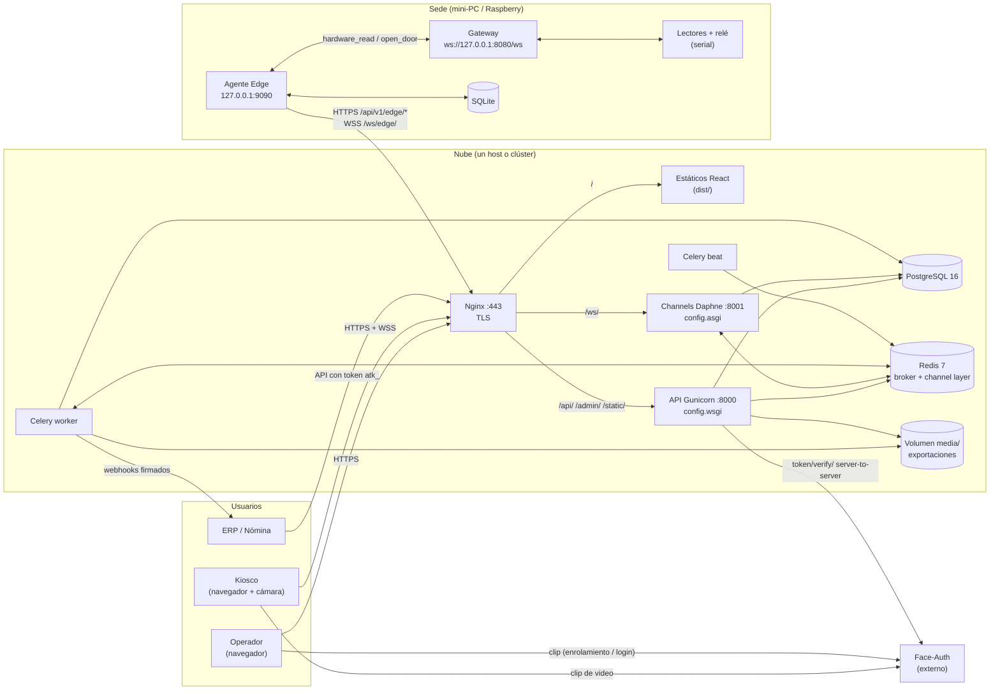

### 1.2. Orden de despliegue

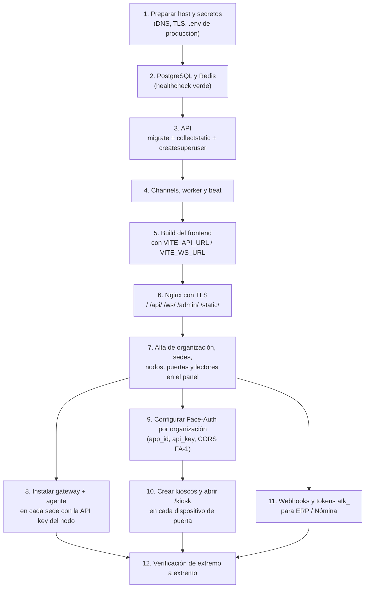

---

## 2. Requisitos previos

| Elemento | Requisito |
| --- | --- |
| Host de nube | Linux con Docker Engine y Docker Compose v2. 2 vCPU / 4 GB como punto de partida. |
| DNS | Un dominio, p. ej. `acceso.ejemplo.com`, apuntando al host. |
| TLS | Certificado válido. **Obligatorio**: el kiosco y la captura facial usan `getUserMedia`, que el navegador solo permite en contexto seguro (HTTPS o `localhost`). |
| Puertos expuestos | Solo `443` (y `80` para redirigir). PostgreSQL, Redis, `8000` y `8001` no se publican. |
| Sedes | Mini-PC o Raspberry (Linux amd64/arm64 o Windows amd64) con NTP, salida HTTPS a la nube y los lectores/relé por serial. |
| Face-Auth | Una `Application` por organización y los orígenes del panel autorizados en CORS (FA-1). |
| Herramientas de build | Docker para backend y frontend; Go 1.23 para compilar el agente. |

---

## 3. Variables de entorno de la nube

Todas las lee `backend/config/settings/base.py`. Los servicios API, Channels, worker y beat comparten **el mismo** conjunto.

| Variable | Producción | Notas |
| --- | --- | --- |
| `DJANGO_SETTINGS_MODULE` | `config.settings.production` | `asgi.py` y `celery.py` usan `local` por defecto: hay que fijarla explícitamente en los cuatro servicios. |
| `DJANGO_SECRET_KEY` | aleatoria, ≥ 50 caracteres | `production.py` falla al arrancar si se deja la de desarrollo. |
| `DJANGO_DEBUG` | `false` | `production.py` fuerza `DEBUG = False`. |
| `DJANGO_ALLOWED_HOSTS` | `acceso.ejemplo.com,api,channels` | Incluir los nombres internos que usa Nginx. |
| `CORS_ALLOWED_ORIGINS` | `https://acceso.ejemplo.com` | Si panel y API comparten dominio, basta el propio. |
| `CSRF_TRUSTED_ORIGINS` | `https://acceso.ejemplo.com` | Necesario para `/admin/`. |
| `DATABASE_URL` o `POSTGRES_*` | credenciales reales | `DATABASE_URL` tiene prioridad. |
| `REDIS_URL` | `redis://redis:6379/0` | Broker de Celery, resultados y channel layer. |
| `FIELD_ENCRYPTION_KEY` | llave Fernet nueva | Cifra `api_key` de Face-Auth y secretos de webhooks. `production.py` falla con la de desarrollo. **Respaldarla**: sin ella esos campos no se pueden leer. |
| `FACEAUTH_WEB_URL` / `FACEAUTH_API_URL` | URLs reales de Face-Auth | Valores por defecto de plataforma; `app_id` y `api_key` viven por organización en la base. |
| `FACEAUTH_VERIFY_TIMEOUT_SECONDS` | `3` | Timeout de `token/verify/`. |
| `FACE_IDENTIFY_TIMEOUT_SECONDS` | `8` | Espera máxima de la decisión del agente para el kiosco. |
| `FRONTEND_URL` | `https://acceso.ejemplo.com` | Enlaces de enrolamiento facial. |
| `RUN_MIGRATIONS` | `1` **solo en la API** | `entrypoint.sh` ejecuta `migrate` y `collectstatic`. Dejarla en `0` en los demás servicios evita migraciones concurrentes. |
| `REPORT_RANGE_MAX_DAYS`, `EXPORT_LINK_TTL_SECONDS` | opcionales | Por defecto 366 días y 24 h. |
| `EDGE_DELTA_DEFAULT_LIMIT`, `EDGE_DELTA_MAX_LIMIT`, `EDGE_LOG_BATCH_MAX`, `EDGE_HEARTBEAT_TIMEOUT_MINUTES` | opcionales | Por defecto 500, 1000, 500 y 3 min. |

Generar las llaves:

```bash
python -c "import secrets; print(secrets.token_urlsafe(64))"                       # DJANGO_SECRET_KEY
python -c "from cryptography.fernet import Fernet; print(Fernet.generate_key().decode())"  # FIELD_ENCRYPTION_KEY
```

Guárdelas en `infra/.env.prod` (fuera de git) o en el gestor de secretos del proveedor.

---

## 4. Servicios de datos: PostgreSQL y Redis

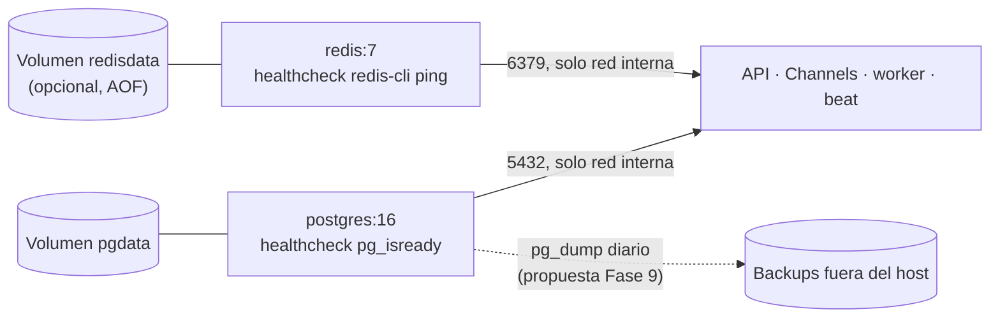

Pasos:

1. Use contraseñas propias en `POSTGRES_PASSWORD`; el compose de desarrollo usa `attendance`.
2. **No publique** el puerto: en desarrollo se expone `5433:5432`, en producción se elimina `ports`.
3. Redis guarda colas de Celery y el channel layer. Perderlo no corrompe datos (las marcaciones son idempotentes por UUID del agente y los comandos tienen TTL), pero activar AOF (`redis-server --appendonly yes`) evita perder tareas encoladas.
4. Backups (_propuesta, pendiente en Fase 9_):

   ```bash
   docker compose exec -T db pg_dump -U attendance -Fc attendance > backup-$(date +%F).dump
   # Restauración en entorno limpio:
   docker compose exec -T db pg_restore -U attendance -d attendance --clean < backup-AAAA-MM-DD.dump
   ```

   El criterio de aceptación de la Fase 9 es restaurar en < 30 min siguiendo el runbook.

---

## 5. Backend: API, Channels, worker y beat

Los cuatro servicios usan **la misma imagen** construida desde `backend/Dockerfile` (Python 3.12, `requirements.txt`) y cambian solo el comando.

| Servicio | Comando | Puerto | Rol |
| --- | --- | --- | --- |
| `api` | `gunicorn config.wsgi:application --bind 0.0.0.0:8000 --workers 4` | 8000 | REST `/api/v1/`, `/admin/`, OpenAPI, estáticos vía WhiteNoise. |
| `channels` | `daphne -b 0.0.0.0 -p 8001 config.asgi:application` | 8001 | `ws/edge/`, `ws/dashboard/`, `ws/kiosk/`. |
| `worker` | `celery -A config.celery worker --loglevel=info` | — | Exportaciones, entrega de webhooks con reintentos, tareas de sync. |
| `beat` | `celery -A config.celery beat --loglevel=info` | — | Programación periódica (ver tabla abajo). **Una sola réplica.** |

Tareas de beat (`CELERY_BEAT_SCHEDULE`):

| Tarea | Frecuencia | Efecto |
| --- | --- | --- |
| `mark_stale_nodes_offline_task` | 60 s | Marca offline los nodos sin latido en `EDGE_HEARTBEAT_TIMEOUT_MINUTES`. |
| `expire_edge_commands` | 5 s | Expira comandos al agente vencidos por TTL. |
| `reconcile_occupancy_task` | 03:20 UTC | Recalcula el aforo y corrige derivas. |
| `rebuild_daily_attendance` | 02:30 UTC | Reconstruye `DailyAttendance`. |

### 5.1. Arranque de la API

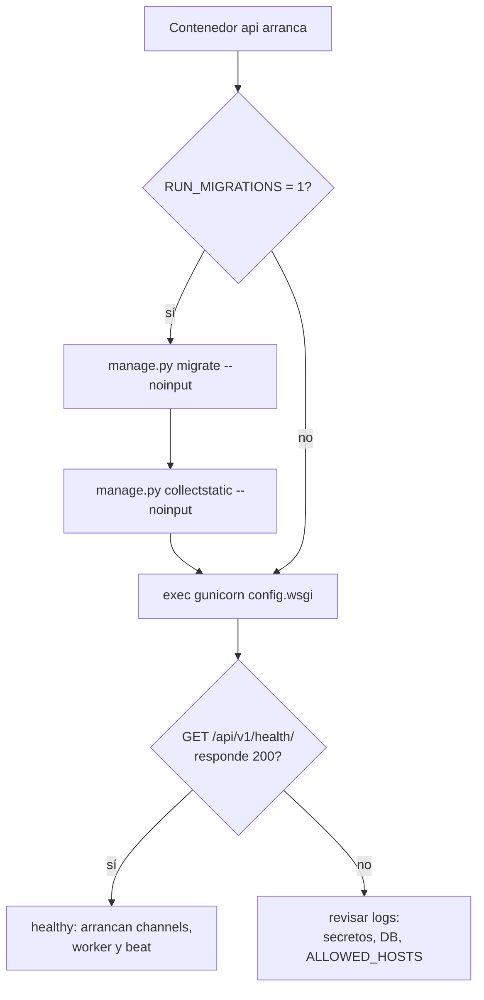

### 5.2. Pasos

1. Construir y publicar la imagen:

   ```bash
   docker build -t registry.ejemplo.com/attendance-backend:$(git rev-parse --short HEAD) backend/
   ```

2. Levantar `db` y `redis`, luego `api` con `RUN_MIGRATIONS=1`. Esperar `healthy`.
3. Crear el superusuario de plataforma (rol `SUPERADMIN`, administra organizaciones):

   ```bash
   docker compose exec api python manage.py createsuperuser
   ```

   `seed_demo` está deshabilitado en producción (`ALLOW_DEMO_SEED = False`); úselo solo en staging con `config.settings.local`.
4. Levantar `channels`, `worker` y `beat` con `RUN_MIGRATIONS=0`.
5. **Volumen compartido de media.** El worker escribe las exportaciones en `MEDIA_ROOT` (`/app/media`) y la API las sirve con `FileResponse`. En desarrollo comparten el bind mount `../backend:/app`; en producción hay que montar el **mismo volumen** `media:/app/media` en `api` y `worker`. Si corren en hosts distintos, use almacenamiento compartido (NFS u objeto).
6. Quitar `--reload` y los bind mounts de código del compose de desarrollo: en producción el código va dentro de la imagen.

### 5.3. Escalado

- `api` y `channels` escalan horizontalmente (Channels comparte estado por Redis).
- `worker` escala por réplicas o `--concurrency`.
- `beat` debe tener **exactamente una** réplica o las tareas periódicas se duplican.

---

## 6. Frontend: panel y kiosco

El `frontend/Dockerfile` actual sirve el **servidor de desarrollo de Vite** (`npm run dev`). En producción se compila a estáticos y los sirve Nginx.

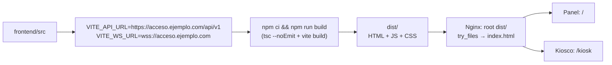

Pasos:

1. Las variables `VITE_*` se **incrustan en tiempo de build**: cambiar de dominio exige recompilar.

   | Variable | Valor | Uso |
   | --- | --- | --- |
   | `VITE_API_URL` | `https://acceso.ejemplo.com/api/v1` | Cliente Axios. |
   | `VITE_WS_URL` | `wss://acceso.ejemplo.com` | Origen de `ws/dashboard/` y `ws/kiosk/`. Si falta, se deriva cambiando el puerto 8000 por 8001, lo que no sirve detrás de Nginx. |

2. Compilar (_propuesta_ de Dockerfile multi-etapa, p. ej. `frontend/Dockerfile.prod`):

   ```dockerfile
   FROM node:22-alpine AS build
   WORKDIR /app
   COPY package.json package-lock.json ./
   RUN npm ci
   COPY . .
   ARG VITE_API_URL
   ARG VITE_WS_URL
   RUN npm run build

   FROM nginx:1.27
   COPY --from=build /app/dist /usr/share/nginx/html
   ```

3. La SPA usa rutas del lado del cliente (`/kiosk/*`, `/kiosk/callback`, `/auth/faceauth/return`, `/enroll/faceauth/callback`): Nginx debe responder `index.html` para cualquier ruta no estática (`try_files $uri /index.html`).
4. Antes de publicar, la CI ya ejecuta `npm run lint`, `npm test` y Playwright (`e2e/operator.spec.ts`, `e2e/kiosk.spec.ts`).

---

## 7. Nginx (proxy inverso y TLS)

`infra/nginx/nginx.conf` ya enruta `/api/`, `/admin/`, `/static/` a Gunicorn, `/ws/` a Daphne con `Upgrade` y `proxy_read_timeout 3600s`, y `/` al servidor de Vite. En producción cambian tres cosas: TLS, `/` sirve `dist/` y cabeceras de seguridad.

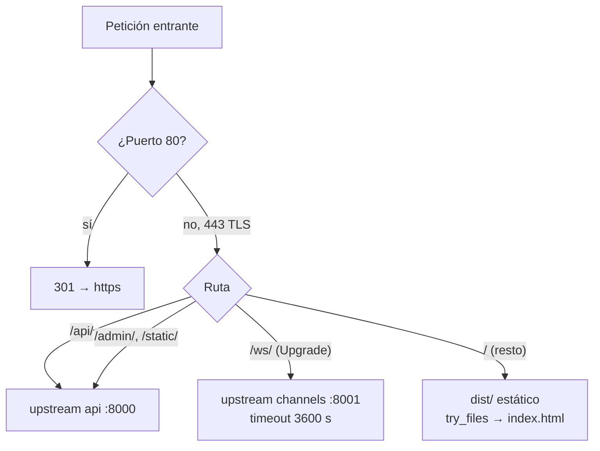

_Propuesta_ de `infra/nginx/nginx.prod.conf`:

```nginx
server {
    listen 80;
    server_name acceso.ejemplo.com;
    return 301 https://$host$request_uri;
}

server {
    listen 443 ssl http2;
    server_name acceso.ejemplo.com;
    ssl_certificate     /etc/letsencrypt/live/acceso.ejemplo.com/fullchain.pem;
    ssl_certificate_key /etc/letsencrypt/live/acceso.ejemplo.com/privkey.pem;
    client_max_body_size 20m;

    add_header Strict-Transport-Security "max-age=31536000" always;
    add_header Permissions-Policy "camera=(self)" always;
    # CSP: connect-src debe incluir el api_url de Face-Auth de cada organización (Fase 9).
    add_header Content-Security-Policy "default-src 'self'; connect-src 'self' wss://acceso.ejemplo.com https://faceauth.ejemplo.com; media-src 'self' blob:; img-src 'self' data: blob:" always;

    location /api/    { proxy_pass http://api:8000;  include /etc/nginx/proxy_params_attendance; }
    location /admin/  { proxy_pass http://api:8000;  include /etc/nginx/proxy_params_attendance; }
    location /static/ { proxy_pass http://api:8000;  proxy_set_header Host $host; }

    location /ws/ {
        proxy_pass http://channels:8001;
        proxy_http_version 1.1;
        proxy_set_header Upgrade $http_upgrade;
        proxy_set_header Connection "upgrade";
        include /etc/nginx/proxy_params_attendance;
        proxy_read_timeout 3600s;
    }

    location / {
        root /usr/share/nginx/html;
        try_files $uri /index.html;
    }
}
```

`proxy_params_attendance` contiene `Host`, `X-Forwarded-For` y `X-Forwarded-Proto $scheme`. Este último es necesario: `production.py` confía en `SECURE_PROXY_SSL_HEADER` para saber que la petición llegó por HTTPS. `/api/v1/edge/commands/` hace long-poll de hasta 25 s, dentro del `proxy_read_timeout 60s` por defecto.

Certificado con Let's Encrypt (`certbot certonly --webroot` o `--standalone`) y renovación automática por cron o timer de systemd.

---

## 8. Compose de producción (propuesta)

Mientras la Fase 9 no entregue `infra/docker-compose.prod.yml`, este es el punto de partida. Se diferencia del de desarrollo en: sin bind mounts de código, sin puertos internos publicados, `config.settings.production`, migraciones solo en `api`, volumen `media` compartido y frontend compilado dentro de Nginx.

```yaml
name: attendance-prod

x-django: &django
  image: registry.ejemplo.com/attendance-backend:${TAG}
  env_file: .env.prod
  restart: unless-stopped
  volumes:
    - media:/app/media
  depends_on:
    db: { condition: service_healthy }
    redis: { condition: service_healthy }

services:
  db:
    image: postgres:16
    env_file: .env.prod
    volumes: [pgdata:/var/lib/postgresql/data]
    healthcheck:
      test: ["CMD-SHELL", "pg_isready -U $${POSTGRES_USER} -d $${POSTGRES_DB}"]
      interval: 5s
      retries: 20
    restart: unless-stopped

  redis:
    image: redis:7
    command: redis-server --appendonly yes
    volumes: [redisdata:/data]
    healthcheck: { test: ["CMD", "redis-cli", "ping"], interval: 5s, retries: 20 }
    restart: unless-stopped

  api:
    <<: *django
    environment: { RUN_MIGRATIONS: "1" }
    command: gunicorn config.wsgi:application --bind 0.0.0.0:8000 --workers 4
    healthcheck:
      test: ["CMD", "python", "-c", "import urllib.request; urllib.request.urlopen('http://127.0.0.1:8000/api/v1/health/')"]
      interval: 10s
      retries: 30
      start_period: 40s

  channels:
    <<: *django
    command: daphne -b 0.0.0.0 -p 8001 config.asgi:application

  worker:
    <<: *django
    command: celery -A config.celery worker --loglevel=info

  beat:
    <<: *django
    command: celery -A config.celery beat --loglevel=info

  nginx:
    image: registry.ejemplo.com/attendance-web:${TAG}   # frontend/Dockerfile.prod
    volumes:
      - ./nginx/nginx.prod.conf:/etc/nginx/conf.d/default.conf:ro
      - /etc/letsencrypt:/etc/letsencrypt:ro
    ports: ["80:80", "443:443"]
    depends_on:
      api: { condition: service_healthy }
      channels: { condition: service_started }
    restart: unless-stopped

volumes:
  pgdata:
  redisdata:
  media:
```

`.env.prod` define `DJANGO_SETTINGS_MODULE=config.settings.production`, `RUN_MIGRATIONS=0` y el resto de la sección 3. El `faceauth-mock` **no** se despliega en producción.

Despliegue de una nueva versión:

```bash
export TAG=$(git rev-parse --short HEAD)
docker compose -f infra/docker-compose.prod.yml pull
docker compose -f infra/docker-compose.prod.yml up -d api        # migra primero
docker compose -f infra/docker-compose.prod.yml up -d            # resto de servicios
```

---

## 9. Configuración inicial en el panel

Con la nube arriba, el superusuario prepara cada organización antes de instalar sedes:

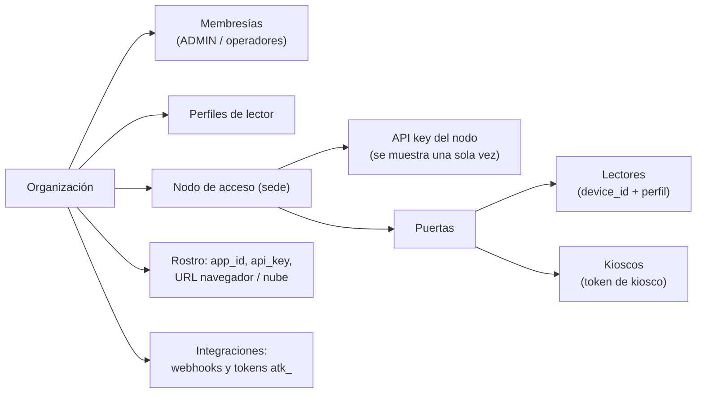

Guarde la **API key del nodo** y el **token de kiosco** al crearlos: la nube solo guarda su hash.

---

## 10. Sede: gateway de hardware y agente Edge

Cada sede tiene dos binarios en la misma máquina. El gateway (repo externo) traduce serial ↔ WebSocket solo en loopback; el agente valida en local contra SQLite y sincroniza con la nube. Guía de detalle: [`edge-install.md`](edge-install.md) y [`edge/README.md`](../edge/README.md).

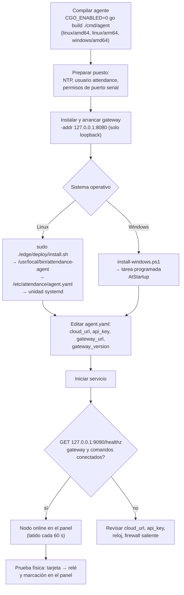

### 10.1. Pasos

1. **Compilar** (Go 1.23):

   ```bash
   cd edge
   CGO_ENABLED=0 GOOS=linux GOARCH=arm64 go build -o bin/agent ./cmd/agent   # Raspberry
   CGO_ENABLED=0 GOOS=linux GOARCH=amd64 go build -o bin/agent ./cmd/agent   # mini-PC
   CGO_ENABLED=0 GOOS=windows GOARCH=amd64 go build -o bin/agent.exe ./cmd/agent
   ./bin/agent -version   # 0.3.0
   ```

   `install.sh` copia `edge/bin/agent`: compile con ese nombre para la arquitectura del puesto.

2. **Preparar el puesto** (Linux):

   ```bash
   sudo useradd --system --home /var/lib/attendance --shell /usr/sbin/nologin attendance
   sudo timedatectl set-ntp true          # o chrony
   ```

3. **Gateway**: instálelo según su propio repositorio y arránquelo **solo en loopback** (`-addr 127.0.0.1:8080`). Sin hardware, use el simulador: `go build -o bin/gateway-sim ./cmd/gateway-sim && ./bin/gateway-sim -addr 127.0.0.1:8080`.
4. **Agente**:

   ```bash
   sudo env GATEWAY_BIN=/usr/local/bin/gateway ./edge/deploy/install.sh
   sudo chown -R attendance:attendance /etc/attendance /var/lib/attendance
   sudoedit /etc/attendance/agent.yaml
   sudo systemctl start attendance-agent
   journalctl -u attendance-agent -f        # logs JSON
   ```

   Valores mínimos de `agent.yaml` en producción:

   ```yaml
   cloud_url: https://acceso.ejemplo.com     # https → el canal de comandos usa wss://…/ws/edge/
   api_key: "<API key del nodo>"
   gateway_url: ws://127.0.0.1:8080/ws
   sqlite_path: /var/lib/attendance/agent.db
   listen_addr: 127.0.0.1:9090
   gateway_version: "<versión probada del gateway>"
   ```

   Las variables `EDGE_CLOUD_URL`, `EDGE_API_KEY`, `EDGE_GATEWAY_URL`, `EDGE_SQLITE_PATH` y `EDGE_LISTEN_ADDR` pisan el archivo.

5. **Verificar**: `curl -s 127.0.0.1:9090/healthz` y `curl -s 127.0.0.1:9090/metrics`. El nodo debe verse online en el panel.

### 10.2. Reglas de seguridad de la sede

- Ni el puerto del gateway (`8080`) ni el de salud del agente (`9090`) deben salir de la máquina.
- `agent.yaml` con permisos `0640` y dueño `attendance`: contiene la API key.
- La autenticación Edge hoy es `Authorization: Bearer <api_key>`. La firma HMAC por petición y la rotación con periodo de gracia son de la Fase 9 (ADR-007, pendiente).
- **Fase 3 abierta:** antes de producción, repetir la prueba con el lector y el relé reales del puesto (P17) y completar [`edge-latency.md`](edge-latency.md) (p95 de validación < 200 ms).

---

## 11. Kiosco facial

El kiosco no es un servicio aparte: es la ruta `/kiosk` del mismo frontend abierta en un dispositivo con cámara junto a la puerta. No habla con el gateway ni con el agente.

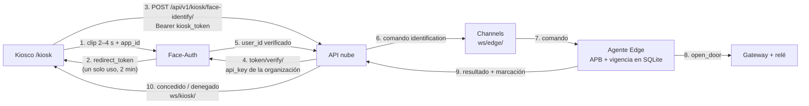

Pasos de despliegue:

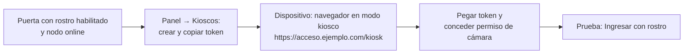

- Requiere **HTTPS** (cámara) y conectividad a Face-Auth. Sin Internet el kiosco pide usar la tarjeta y la puerta sigue operando por el agente.
- Use el modo kiosco del navegador (p. ej. `chromium --kiosk --app=https://acceso.ejemplo.com/kiosk`) y fije el permiso de cámara para el origen.

---

## 12. Face-Auth (servicio externo)

No se despliega desde este repo; se **configura** por organización. Guía de detalle: [`faceauth-integration.md`](faceauth-integration.md).

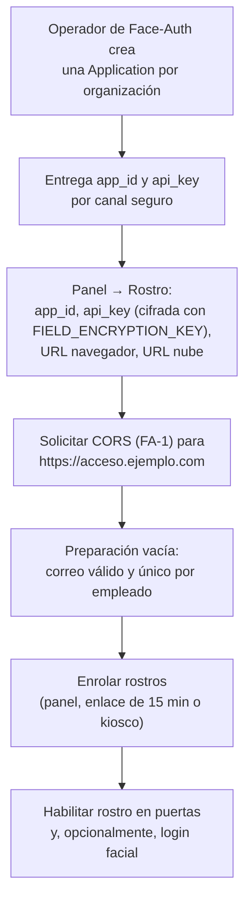

- **URL para el navegador**: la que alcanzan panel y kiosco. **URL para la nube**: solo si la API no puede usar la misma (red interna); vacía, usa la del navegador.
- Rutas de retorno del flujo alojado (fallback sin `MediaRecorder`): `/auth/faceauth/return`, `/kiosk/callback`, `/enroll/faceauth/callback`.
- **Bloqueante para producción:** FA-1 (CORS), FA-5 (`redirect_token` sin `redirect_uri`) y FA-8 (staging). Hasta resolverlos, la integración solo está validada contra `infra/faceauth-mock/`.

---

## 13. Integraciones: webhooks y ERP

El worker entrega los webhooks; no hay servicio extra. Detalle en [`integrations.md`](integrations.md).

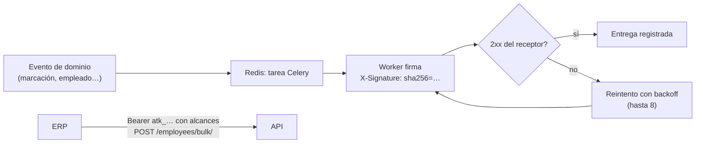

- El host de la nube necesita **salida HTTPS** hacia los receptores.
- Cree los tokens `atk_` con el alcance mínimo y entréguelos por canal seguro.

---

## 14. Verificación de extremo a extremo

| # | Comprobación | Resultado esperado |
| --- | --- | --- |
| 1 | `curl https://acceso.ejemplo.com/api/v1/health/` | `200` |
| 2 | Login en el panel y cambio de organización | Dashboard carga y `ws/dashboard/` conecta (sin errores en consola). |
| 3 | `/admin/` | Estilos cargan (estáticos de WhiteNoise). |
| 4 | Nodo de la sede | Online; `healthz` del agente con gateway y comandos conectados. |
| 5 | Tarjeta en lector | Relé acciona y la marcación aparece en vivo en el tablero. |
| 6 | Desconectar Internet de la sede y pasar tarjeta | Acceso concedido offline; al reconectar, la marcación sube sin duplicados. |
| 7 | Apertura remota desde el panel | Comando llega por `ws/edge/` (o long-poll) y abre. |
| 8 | Kiosco con rostro enrolado | Concedido en < 3 s desde la respuesta de Face-Auth. |
| 9 | Exportación de reporte | El worker genera el archivo y el enlace firmado descarga desde la API. |
| 10 | Webhook de prueba | El receptor valida `X-Signature`. |

---

## 15. Operación y pendientes de la Fase 9

| Tema | Estado hoy | Pendiente |
| --- | --- | --- |
| Logs | stdout de cada contenedor; agente en JSON (`slog`) | Centralización y Sentry (API, frontend, agente). |
| Métricas | Agente expone `/metrics` Prometheus en loopback | Prometheus + Grafana para API, Celery y agentes. |
| Autenticación Edge | Bearer con API key del nodo | HMAC-SHA256 con anti-replay y rotación (ADR-007). |
| Secretos en reposo | `api_key` de Face-Auth cifrada (Fernet) | Cifrado de `Credential.payload`, rotación de llaves documentada, cifrado de `agent.yaml`/SQLite. |
| Cabeceras | CORS por variables | CSP, `Permissions-Policy`, rate limit por organización, 2FA para `ADMIN`. |
| Backups | Manual | Backup automático con prueba de restauración. |
| Runbooks | — | `docs/runbooks/`: nodo offline, cola creciendo, restaurar backup, rotar llaves. |
| Pipeline | CI de tests y lint | Despliegue automático a staging y producción. |
| Actualización del agente | Reinstalar binario | Firma de binarios y actualización remota (P8). |
