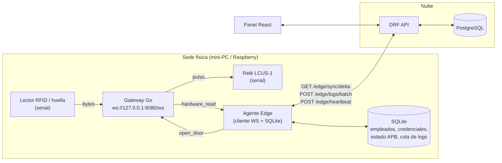
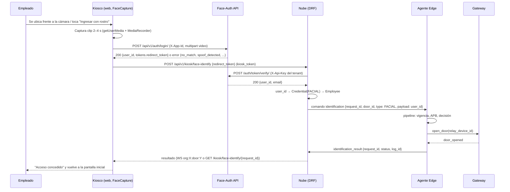

# Plan de Desarrollo: Sistema de Control y Registro de Acceso

> Documento vivo. Cualquier agente o desarrollador que retome el trabajo debe leer primero la sección **0. Contexto para retomar el trabajo** y actualizar la **Bitácora de progreso** al terminar cada sesión.

Documentos fuente:

- [`software-specs.md`](software-specs.md): especificación funcional/técnica (nube, Edge, modelo de datos, protocolo de sync).
- [`hardware-gateway.md`](hardware-gateway.md): guía de integración del gateway serial ↔ WebSocket que corre en el puesto del cliente.
- [`face-auth.md`](face-auth.md): guía de integración de **Face-Auth**, servicio externo de autenticación biométrica facial (SSO multi-tenant, liveness por video). Se usa como método de autorización facial en puertas (vía kiosco) y, opcionalmente, como login del panel.

---

## 0. Contexto para retomar el trabajo

### 0.1. Estado actual del repositorio

| Elemento | Estado |
| --- | --- |
| Código fuente | Monorepo con API Django, panel React de operación y agente Edge en Go (falta la prueba con hardware). |
| Historial git | El código de las fases 0 y 1 está en el árbol de trabajo. El commit inicial de specs es `e888902`. |
| Gateway de hardware | Existe como proyecto Go **externo** en otro repositorio. **No se trae a este repo**: se integra únicamente a través del contrato descrito en `hardware-gateway.md`. Su doc referencia `certificados.md`, que vive en ese otro repo. |
| Face-Auth | Servicio **externo** multi-tenant ya existente (repo aparte). Se integra únicamente por el contrato de `face-auth.md` en **modo headless** (Modo B: `auth/login/`, `auth/register/`, `otp/*` desde nuestro frontend; `token/verify/` server-to-server desde nuestra nube). Una `Application` de Face-Auth por organización. Sus docs referencian `ARCHITECTURE.md`, `OPERATIONS.md` y `MASTER_PLAN.md`, que viven en ese otro repo. |
| Infraestructura | `infra/docker-compose.yml` (API, worker, Channels, PostgreSQL 16, Redis, Nginx, frontend). |
| Modelo de despliegue | **Multi-tenant** (varias organizaciones/clientes en una misma instalación). Confirmado 2026-10-18. |
| Fase activa | **Fase 5** (tiempo real y aforo). La Fase 4 está hecha. La Fase 3 sigue abierta solo por la prueba con hardware (P17). |

### 0.2. Qué construye este proyecto (resumen de una pantalla)

Sistema híbrido nube–edge **multi-tenant** para controlar el acceso físico de colaboradores de varias organizaciones (clientes) desde una misma instalación:

1. **Nube (Django REST Framework + PostgreSQL + Celery/Redis + Channels):** fuente de la verdad, panel de administración, reportes, webhooks. Todos los datos de dominio pertenecen a una `Organization`.
2. **Panel web (React + TypeScript + TanStack Query + Zustand + Axios):** administración de empleados, credenciales, nodos, puertas; dashboard en tiempo real; reportes. Un usuario opera dentro de una organización a la vez.
3. **Agente Edge (Go, binario independiente):** corre en un mini-PC/Raspberry en cada sede, junto al gateway. Mantiene una copia local en SQLite de empleados y credenciales de **su** organización, valida accesos en < 200 ms sin Internet, aplica anti-passback, acciona el relé vía gateway y encola marcaciones para subirlas por lotes. Es **agnóstico del hardware**: solo conoce el protocolo del gateway y perfiles de lector configurables.
4. **Gateway de hardware (Go, ya existe, repo externo):** puente serial ↔ WebSocket en `127.0.0.1:8080/ws`. Emite `hardware_read` cuando un lector entrega un identificador y ejecuta `open_door` sobre un relé. Se trata como caja negra: la única dependencia es el contrato de `hardware-gateway.md`.
5. **Face-Auth (servicio externo, repo aparte):** autenticación facial por video con liveness. Cada organización nuestra se mapea a un tenant (`Application`) de Face-Auth. Se integra en **modo headless** (Modo B de la guía): nuestro frontend captura el clip con la cámara del dispositivo y lo envía **directamente** a Face-Auth; recibimos un `redirect_token` de un solo uso que nuestra nube verifica server-to-server. Lo usamos para (a) **marcación facial en puertas** mediante un **kiosco**, (b) **enrolamiento facial** desde el panel o el kiosco y (c) **login del panel**. Nuestro backend nunca ve video ni embeddings: solo recibe un `user_id` verificado.
6. **Kiosco (modo de la app React):** pantalla web que corre en cualquier dispositivo con navegador y cámara junto a la puerta. Captura el rostro con el componente `FaceCapture`, llama a Face-Auth, envía el `redirect_token` a la nube y muestra el resultado (concedido/denegado). No habla con el gateway ni con el agente directamente.

Dos vías de identificación conviven:

| Vía | Credenciales | Quién valida | Requiere Internet | Latencia objetivo |
| --- | --- | --- | --- | --- |
| **Local (Edge)** | RFID, huella, PIN, terminales faciales seriales | Agente Edge contra SQLite | No | < 200 ms |
| **Online (Face-Auth)** | Rostro vía kiosco | Face-Auth identifica; la nube mapea a empleado y despacha al agente, que aplica APB y abre | Sí | < 3 s desde la respuesta de Face-Auth hasta `door_opened` (sin contar captura ni liveness) |

### 0.3. Decisión arquitectónica clave: cómo encajan el gateway y el Agente Edge

Los dos documentos fuente describen modelos distintos:

| | `software-specs.md` | `hardware-gateway.md` |
| --- | --- | --- |
| Quién valida la credencial | Agente Edge contra SQLite local | El navegador llama al API en la nube (`POST /identificaciones`) |
| Funciona sin Internet | Sí (requisito central) | No |
| Quién manda `open_door` | Agente Edge | El navegador |

**Decisión confirmada (ADR-001, 2026-10-18):** el gateway se conserva **tal cual** como capa de abstracción de hardware, y el **Agente Edge es un binario independiente** con responsabilidad propia. Corre en la misma máquina, se conecta como cliente WebSocket a `ws://127.0.0.1:8080/ws`, consume `hardware_read`, valida localmente y envía `open_door`. El navegador deja de ser el puente de hardware; el panel web solo habla con la nube.

Razones:

- Cumple el requisito offline-first y < 200 ms sin reescribir el gateway.
- El gateway solo escucha en loopback y no autentica, lo cual es aceptable si el único cliente es el agente local.
- Mantiene el gateway reutilizable para otros proyectos y con su propio ciclo de versiones.

Alternativas descartadas: (a) fusionar agente y gateway en un solo binario Go (acopla el gateway a este dominio); (b) mantener el navegador como puente (incumple offline-first).

**Cómo se integra el gateway (P2):** vive en otro repositorio y **no** se incorpora como submódulo ni copia. La integración es exclusivamente por el contrato de `hardware-gateway.md`. Consecuencias:

- El agente fija en su `README` la versión del gateway contra la que fue probado y el instalador de sede despliega ambos binarios.
- Cualquier cambio del protocolo del gateway se trata como cambio de dependencia externa: se actualiza `docs/hardware-gateway.md`, se adapta `edge/internal/gateway` y se registra en la bitácora.
- El **simulador de gateway** (Fase 3) implementa ese mismo contrato y es la referencia de tests; si el gateway real diverge, el simulador se corrige primero.

**Independencia del hardware (P3):** el agente no conoce marcas ni modelos de lectores. Lo que un lector entrega llega como `hardware_read.data` (texto) por un `device_id`. La nube define, por cada lector, un **perfil de lector** (`ReaderProfile`: tipo de credencial que produce y reglas de normalización del `data`, p. ej. recortar, mayúsculas, quitar ceros a la izquierda, expresión regular de captura, conversión decimal↔hex). El agente aplica el perfil y busca la credencial por `(type, payload_normalizado)`. Así, cambiar de lector es cambiar configuración, no código. El enrolamiento específico por fabricante se difiere a Fase 10.



### 0.3.1. Decisión de multi-tenancy (ADR-002)

El sistema aloja **varias organizaciones** (clientes) en una sola instalación. Estrategia adoptada: **base de datos compartida con columna `organization_id`** en todas las entidades de dominio (en lugar de un esquema PostgreSQL por tenant tipo `django-tenants`).

Razones: menos complejidad operativa (una sola migración, un solo pool), compatible con la secuencia global de `version`, con Celery y con Channels sin trucos de enrutamiento; el aislamiento se garantiza en la capa de aplicación.

Reglas que todo el código debe cumplir:

| Regla | Detalle |
| --- | --- |
| Toda entidad de dominio tiene `organization` | `Employee`, `Department`, `Credential`, `AccessNode`, `Door`, `Zone`, `AccessLog`, `Schedule`, `WebhookSubscription`, `APIToken`… Único modelo global: `Organization` y la cuenta de usuario. |
| Resolución del tenant | Panel: el JWT incluye `org_id`; un middleware fija el tenant en el contexto de la petición. Edge: el `api_key` del nodo pertenece a una organización y define el tenant. Integraciones: el `APIToken` pertenece a una organización. |
| Managers con filtro obligatorio | Un `TenantManager` filtra por el tenant del contexto; el acceso sin tenant (p. ej. tareas Celery) debe ser explícito (`Model.all_objects`) y auditado. |
| Unicidades son por tenant | `Employee.document_id` y `Credential (type, payload)` son únicos **por organización**, no globales. |
| Roles por membresía | `Membership(user, organization, role)`. Un usuario puede pertenecer a varias organizaciones; el panel ofrece un selector. Rol de plataforma `SUPERADMIN` (sin tenant) para administrar organizaciones. |
| Tiempo real y webhooks aislados | Grupos de Channels y suscripciones de webhooks siempre con prefijo/FK de organización. |
| Pruebas de aislamiento | Toda suite incluye un test que, con dos organizaciones sembradas, verifica que ninguna lectura cruza el límite. |

### 0.3.2. Decisión de autenticación facial con Face-Auth (ADR-009)

Face-Auth es un servicio en la nube que identifica personas con un clip de video (liveness + matching) y entrega un **JWT de un solo uso** (`sso_redirect`, TTL 2 min) que se verifica server-to-server con `POST /api/v1/auth/token/verify/` y la `api_key` del tenant. No pasa por el gateway serial, necesita Internet y tarda segundos, por lo que **no sustituye** la vía local offline: es una **segunda vía de identificación, online**.

Decisiones:

| Tema | Decisión |
| --- | --- |
| Mapeo de tenants | Una `Organization` nuestra ↔ un tenant (`Application`) de Face-Auth; Face-Auth es multi-tenant y cada organización tiene su `app_id`/`api_key` y sus propios usuarios y perfiles biométricos. Modelo `FaceAuthIntegration(organization, app_id, api_key cifrada, api_url, enabled, allow_panel_login)`. El alta del tenant en Face-Auth la hace su operador (panel/CLI, sin API); nosotros guardamos `app_id` y `api_key`. |
| Dónde vive la `api_key` de Face-Auth | **Solo en la nube**, cifrada por organización. Nunca en el kiosco, el agente ni el navegador. El navegador solo usa el `app_id` (público). |
| Captura de video | **Modo B, headless (API REST directa):** un componente React propio `FaceCapture` (`getUserMedia` + `MediaRecorder`, clip webm/mp4 de 2–4 s, ≥ 320×240, ≤ 15 MB, con guía visual de encuadre y parpadeo) envía el video **directamente desde el navegador a Face-Auth** (`POST /api/v1/auth/login/` con `X-App-Id`). El video nunca pasa por nuestro backend ni se persiste. Face-Auth devuelve `tokens.redirect_token` (JWT de un solo uso, `purpose=sso_redirect`), que es lo único que el frontend reenvía a nuestra nube. El Modo A (SSO hosted) queda como **fallback** si el navegador no soporta `MediaRecorder`. |
| Qué guardamos como credencial | `Credential(type=FACIAL, payload=<faceauth user_id>)`. **No almacenamos embeddings**: el vector de 512 dimensiones vive en Face-Auth. Esto redefine `FACIAL` respecto a la spec (de "vector" a "referencia de identidad externa") y cumple la directiva de no persistir biometría cruda. |
| Quién decide y quién abre | La nube verifica el `redirect_token` con `token/verify/` (`X-Api-Key`), mapea `user_id` → `Employee` y despacha al **Agente Edge** un comando `identification` (`type=FACIAL`, `payload=user_id`, `door_id`). El agente ejecuta **el mismo pipeline** que para `hardware_read` (credencial activa, vigencia, APB, `open_door`, log). Así hay una sola fuente de marcaciones y un solo estado APB local. |
| Canal nube → agente | Se añade un **canal de comandos** (WebSocket `wss://<api>/ws/edge/` autenticado con el `api_key` del nodo, con fallback a long-poll `GET /api/v1/edge/commands?wait=25`). Es genérico: también sirve para `open_door` remoto, `sync_now`, `enrollment_mode`, `reload`. |
| Si no hay Internet | El kiosco no puede llamar a Face-Auth; muestra "use su tarjeta" y la puerta sigue operando con credenciales locales. |
| Enrolamiento facial | También **headless**, dirigido por nosotros: el operador (panel) o el propio empleado (kiosco, identificándose con documento) selecciona al empleado; el frontend ejecuta `otp/request` → `otp/verify` → `auth/register/` (con `FaceCapture`) usando el email del empleado; la respuesta `201` trae el `user_id`, que el frontend envía (dentro del `redirect_token`) a nuestra nube para crear `Credential(FACIAL)` ya enlazada al empleado elegido. **No hay ambigüedad por email ni `redirect_uri`.** Requisito: el empleado debe tener email accesible para recibir el OTP (P18); los empleados sin email no pueden habilitar rostro y el panel lo señala. |
| Login del panel | Opcional por organización (`allow_panel_login`): la pantalla de login incluye "Ingresar con rostro" → `FaceCapture` → `auth/login/` → `redirect_token` → `POST /api/v1/auth/faceauth/callback` → `verify` → emitimos **nuestro** JWT (intercambio de tokens, §3.4 de la guía). `User.faceauth_user_id` como enlace estable. Los `access`/`refresh` de Face-Auth se descartan. |
| Un solo uso del token | `verify` consume el `redirect_token`: la nube verifica **una sola vez** y persiste el resultado en `FaceIdentificationRequest`; el kiosco consulta el resultado por `request_id`, nunca reenvía el token. |
| Rostro como factor | **Único por defecto** (P21). MFA rostro + tarjeta configurable por puerta en Fase 10. |
| Dispositivo del kiosco | **Indiferente** (P20): es un cliente web. Requisitos mínimos: navegador con `getUserMedia` y `MediaRecorder` (Chrome, Edge, Firefox, Safari ≥ 14.1), cámara, HTTPS. Funciones como Wake Lock o pantalla completa se usan por detección de capacidad, nunca como requisito. |



Por qué headless y no SSO hosted: control total de la UX en el kiosco (sin salir de la página, mensajes propios, reintentos), el enrolamiento queda enlazado al empleado correcto sin depender del email como clave, no hay `redirect_uris` que mantener por entorno, y el mismo `FaceCapture` sirve para kiosco, enrolamiento y login del panel. Costo: debemos implementar la captura, cumplir los requisitos del clip (§4.2 de la guía) y coordinar con el equipo de Face-Auth la **whitelist de CORS** y el **rate limit por `app_id`** (ajustable según demanda, P23). El equipo de Face-Auth es del mismo ecosistema (P24): las necesidades que la guía no cubre se piden como solicitudes formales (sección 4.3).

Alternativas descartadas: (a) que el kiosco llame al agente por LAN (contenido mixto HTTPS→HTTP en el navegador y expone el agente en la red); (b) que el agente guarde la `api_key` de Face-Auth y verifique él mismo (secreto fuera de la nube, rotación difícil, y de todos modos requiere Internet); (c) servicio de visión propio en el Edge (reemplazado por Face-Auth); (d) SSO hosted como vía principal (menos control de UX y enlace de enrolamiento por email; se conserva solo como fallback).

### 0.4. Glosario

| Término | Significado |
| --- | --- |
| **Organización (tenant)** | Cliente/empresa que usa el sistema. Todo dato de dominio le pertenece a una. |
| **Membresía** | Relación usuario ↔ organización con un rol (`ADMIN`, `OPERATOR`, `VIEWER`). |
| **Nodo (AccessNode)** | Un Agente Edge instalado en una sede de una organización. Tiene `api_key` propia. |
| **Puerta / Lector (Door, Reader)** | Punto de acceso físico. Asocia un `device_id` serial de lector, un `device_id` de relé, una dirección (IN/OUT), una zona y un perfil de lector. *No existe en el modelo de la spec; se agrega en Fase 1.* |
| **Perfil de lector (ReaderProfile)** | Configuración que dice qué tipo de credencial produce un lector y cómo normalizar el texto que entrega (`trim`, mayúsculas, regex, hex↔decimal, ceros a la izquierda). Hace al agente independiente del hardware. |
| **Credencial** | Dato que identifica a un empleado ante un lector: UID RFID, ID de huella enrolada en el lector, PIN, o `user_id` de Face-Auth para `FACIAL`. `payload` se guarda ya normalizado según el perfil del lector con que se enroló. |
| **Face-Auth** | Servicio externo multi-tenant de autenticación facial por video (liveness + matching). En modo headless, el navegador le envía el clip y recibe un `redirect_token` de un solo uso que la nube verifica con `token/verify/`. Ver `face-auth.md`. |
| **Headless / Modo B** | Integración en la que nuestro frontend captura el video y llama a la API de Face-Auth directamente (`auth/login/`, `auth/register/`, `otp/*`), sin redirigir al SSO hosted de Face-Auth. |
| **`FaceCapture`** | Componente React compartido (kiosco, enrolamiento, login del panel) que graba el clip con `getUserMedia` + `MediaRecorder`, guía al usuario (encuadre, parpadeo) y traduce los códigos de error de Face-Auth a mensajes accionables. |
| **Kiosco** | Modo de la app React que corre en cualquier dispositivo con navegador y cámara junto a una puerta. Usa `FaceCapture`, llama a Face-Auth y envía el `redirect_token` a la nube con su `kiosk_token`. Está asociado a un `Door`. |
| **Evento de identificación (IdentificationEvent)** | Entrada unificada del pipeline del agente: `{source: gateway\|cloud, door/reader, type, payload, request_id?}`. El gateway produce `hardware_read`; la nube produce comandos `identification` (p. ej. rostro). |
| **Canal de comandos** | WebSocket nube → agente (`/ws/edge/`) con fallback long-poll, para `identification`, `open_door`, `sync_now`, `enrollment_mode`, `reload`. |
| **`version`** | Entero global monótono (secuencia de PostgreSQL) asignado a cada fila de Employee/Credential/Door al crearse o modificarse. Base del sync por deltas. |
| **Delta** | Conjunto de filas con `version > since_version`. |
| **APB (anti-passback)** | Regla que impide (duro) o marca como anomalía (blando) una entrada cuando el empleado ya figura dentro. |
| **Aforo** | Conteo de empleados con `is_inside = true` por sede o zona. |
| **`hardware_read`** | Evento del gateway: `{"event":"hardware_read","data":"<id>","device_id":"COM3"}`. |

### 0.5. Convenciones acordadas

- **Idioma:** código e identificadores en inglés; documentación y mensajes de UI en español.
- **Timestamps:** siempre UTC en tránsito y en BD (ISO 8601 con `Z`). La zona horaria se aplica solo en la presentación.
- **IDs:** UUID v4 generados en origen. Las marcaciones generan su UUID en el Edge y la nube lo usa como clave primaria (idempotencia).
- **Borrados:** nunca físicos en entidades sincronizadas. Se usa `is_active = false` o `deleted_at` para que el delta propague el borrado.
- **API:** versionada bajo `/api/v1/`. Contrato OpenAPI generado por `drf-spectacular` es la fuente de verdad para el cliente TypeScript.
- **Commits:** Conventional Commits (`feat:`, `fix:`, `docs:`, `chore:`…). Una rama por fase o por feature.
- **Definición de hecho (DoD) por fase:** código con tests pasando en CI, docs actualizadas, bitácora actualizada, demo reproducible con `docker compose up`.

### 0.6. Estructura de repositorio propuesta (monorepo)

```text
attendance-system/
├── backend/            # Django + DRF + Channels + Celery
│   ├── config/         # settings, urls, asgi, celery
│   ├── apps/
│   │   ├── tenants/    # Organization, Membership, middleware y TenantManager
│   │   ├── accounts/   # usuarios del panel, JWT
│   │   ├── people/     # Employee, Department, Credential
│   │   ├── access/     # AccessNode, Door, ReaderProfile, AccessLog, APB, aforo
│   │   ├── sync/       # secuencia version, endpoints edge/*, canal de comandos
│   │   ├── kiosk/      # Kiosk, kiosk_token, FaceIdentificationRequest
│   │   ├── reports/    # métricas, exportaciones
│   │   └── integrations/ # webhooks, ERP, faceauth/ (FaceAuthIntegration, cliente verify)
│   └── tests/
├── frontend/           # React + TS + Vite (panel + modo kiosco en /kiosk)
├── edge/               # Agente Edge (Go)
│   ├── cmd/agent/
│   └── internal/{gateway,store,sync,commands,engine,profile,config}
├── infra/              # docker-compose, nginx, scripts
├── docs/
│   ├── software-specs.md
│   ├── hardware-gateway.md
│   ├── face-auth.md
│   ├── development-plan.md   # este archivo
│   └── adr/                  # decisiones de arquitectura (ADR-001, ...)
└── README.md
```

### 0.7. Cómo retomar el trabajo (checklist)

1. Leer `docs/software-specs.md`, `docs/hardware-gateway.md`, `docs/face-auth.md` y este documento completo.
2. Revisar la **Bitácora de progreso** (sección 3) para saber la fase activa y el último entregable cerrado.
3. Revisar `docs/adr/` y la sección **Preguntas abiertas** (sección 4): si una pregunta bloquea la tarea, resolverla con el responsable antes de implementar; si no, implementar bajo la suposición documentada y anotarla.
4. Levantar el entorno: `docker compose up` en `infra/` (cuando exista) y correr la suite de tests.
5. Al terminar la sesión: actualizar bitácora, ADRs si hubo decisiones, y dejar el `README` de cada componente alineado.

---

## 1. Principios del plan

- **Vertical primero:** cada fase termina con algo demostrable de punta a punta (aunque sea con hardware simulado).
- **El protocolo de sync es el contrato más caro de cambiar:** se congela temprano (Fase 2) y se prueba con un Edge simulado antes de tocar hardware.
- **Hardware real al final de cada fase Edge, nunca al inicio:** se desarrolla contra un **simulador del gateway** (mismo protocolo WS) para no depender de puertos seriales.
- **Seguridad incremental pero no opcional:** API key simple en Fase 2, HMAC/rotación en Fase 9; nunca se almacenan biométricos crudos desde el día uno (los embeddings faciales viven en Face-Auth, nunca aquí).
- **Servicios externos siempre con simulador:** gateway (Fase 3) y Face-Auth (Fase 6) tienen un mock que implementa su contrato documentado; el desarrollo y la CI no dependen de hardware ni de un despliegue externo.

---

## 2. Fases y entregables

Las estimaciones son indicativas para un equipo de 2–3 personas (1 backend, 1 frontend, 1 Edge/infra con solapamiento). Las fases 4 y 3 pueden ir en paralelo con la 2 una vez congelado el contrato OpenAPI. La Fase 6 (Face-Auth) requiere cerradas la 2, 3 y 5.

| Fase | Nombre | Dependencias |
| --- | --- | --- |
| 0 | Fundaciones | — |
| 1 | Backend core y modelo de datos | 0 |
| 2 | Protocolo de sync y canal de comandos | 1 |
| 3 | Agente Edge | 2 |
| 4 | Panel web | 1 (contrato OpenAPI) |
| 5 | Tiempo real, APB central y aforo | 2, 4 |
| 6 | Autenticación facial con Face-Auth (kiosco) | 2, 3, 4, 5 |
| 7 | Reportes y exportación | 5 |
| 8 | Webhooks e integración ERP | 5 |
| 9 | Seguridad, observabilidad y despliegue | 6, 7, 8 |
| 10 | Autenticación avanzada (MFA, PIN, QR) | 6 |

### Fase 0: Fundaciones del proyecto (≈ 1 semana)

**Objetivo:** que cualquier persona pueda clonar, levantar y contribuir con un comando.

Tareas:

- Crear estructura de monorepo (sección 0.6) y `README.md` raíz con instrucciones.
- `infra/docker-compose.yml` con servicios: `api` (Django), `worker` (Celery), `channels` (Daphne/Uvicorn), `db` (PostgreSQL 16), `redis`, `nginx`, `frontend` (dev server).
- Backend: proyecto Django 5 + DRF + `drf-spectacular`, settings por entorno (`.env`), `ruff`, `mypy` (opcional), `pytest-django`.
- Frontend: Vite + React + TypeScript, ESLint/Prettier, Vitest, alias de rutas.
- Edge: módulo Go (`edge/go.mod`), `golangci-lint`, estructura `cmd/agent` + `internal/`.
- CI (GitHub Actions o equivalente): lint + tests por componente, build de imágenes Docker.
- `docs/adr/ADR-001-gateway-y-agente-edge.md` (sección 0.3), `docs/adr/ADR-002-multi-tenancy.md` (sección 0.3.1) y `docs/adr/ADR-009-face-auth.md` (sección 0.3.2), ya decididos; solo falta redactarlos en formato ADR.
- Variables de entorno reservadas en `.env.example` para Face-Auth (`FACEAUTH_WEB_URL`, `FACEAUTH_API_URL` por defecto de la plataforma; `app_id`/`api_key` van por organización en BD, no en `.env`).
- Plantilla de ADR y plantilla de PR.

**Entregables:**

- Repo con los tres componentes compilando "hola mundo".
- `docker compose up` levanta API en `http://localhost:8000/api/schema/swagger-ui/` y frontend en `http://localhost:5173`.
- CI verde.
- ADR-001, ADR-002 y ADR-009 escritos.

**Criterios de aceptación:** un desarrollador nuevo levanta todo en < 15 min siguiendo el README.

---

### Fase 1: Backend core, modelo de datos y administración básica (≈ 2 semanas)

**Objetivo:** modelo de datos completo, aislado por organización, y CRUD autenticado vía API, documentado en OpenAPI.

Tareas (en este orden; el tenant va **antes** que cualquier otra entidad):

- **`tenants`:** `Organization` (`name`, `slug`, `timezone`, `is_active`, `settings` JSON), `Membership(user, organization, role)`, middleware que fija el tenant desde el JWT / api_key / APIToken, `TenantModel` abstracto con FK `organization` y `TenantManager`. Rol de plataforma `SUPERADMIN` para CRUD de organizaciones.
- Implementar modelos de la spec (`TimeStampedModel`, `Employee`, `Credential`, `AccessNode`, `AccessLog`) heredando de `TenantModel`, con estas **extensiones necesarias** que la spec no cubre:
  - `Department` (FK desde `Employee`) para métricas por departamento.
  - `Zone` (aforo por zona).
  - `ReaderProfile`: `name`, `credential_type`, `normalization` (JSON ordenado de pasos: `trim`, `upper`, `strip_leading_zeros`, `regex_extract`, `hex_to_dec`, `dec_to_hex`, `pad_left`), `min_length`, `max_length`. Se sincroniza al Edge junto con las puertas. Incluir perfiles predefinidos de ejemplo (RFID hex 8 dígitos, RFID decimal 10 dígitos, ID numérico de lector de huella).
  - `Door` / `Reader`: `node`, `name`, `reader_device_id`, `reader_profile`, `relay_device_id`, `direction` (IN/OUT), `zone`, `apb_mode` (OFF/SOFT/HARD), `required_factors` (MFA; Fase 10), `face_enabled` (si acepta identificación facial vía kiosco). Un `Door` puede tener varios lectores (p. ej. tarjeta + huella) → modelar `Reader` como tabla hija de `Door`.
  - `AccessNode`: agregar `site`, `timezone`, `last_heartbeat_at`, `is_online`, `api_key_hash` (la llave en claro solo se muestra una vez al crearla), `gateway_version_reported`.
  - `Credential.payload`: texto ya normalizado según el `ReaderProfile` usado al enrolar; `Credential.reader_profile` opcional para trazabilidad. Para `FINGERPRINT` el valor típico es el ID que el lector entrega por serial (el matching 1:N ocurre en el lector); si un hardware entrega template, el perfil lo declara y el `payload` lo almacena como hash/vector no reversible. Para `FACIAL` el `payload` es el **`user_id` (UUID) de Face-Auth** del empleado en el tenant de la organización; nunca un embedding ni una imagen (ADR-009).
  - `Credential.source`: `MANUAL`, `ASSISTED_ENROLLMENT`, `FACEAUTH`, para trazabilidad del origen.
  - Unicidades **por organización**: `(organization, document_id)` en `Employee`; índice único parcial `(organization, type, payload) WHERE is_active` en `Credential`.
  - **Face-Auth (modelos; la lógica va en Fase 6):** `FaceAuthIntegration(organization 1:1, app_id, api_key` cifrado con llave de aplicación`, api_url, web_url` (solo para el fallback hosted)`, enabled, allow_panel_login, allow_kiosk_self_enrollment)`; `Kiosk(organization, door, name, kiosk_token_hash, is_active, last_seen_at)` (un dispositivo web por puerta, autenticado con su propio token); `User.faceauth_user_id` (nullable, único) para login del panel; `FaceEnrollmentSession(organization, employee, started_by: user|kiosk, status, faceauth_user_id, created_at, expires_at)` para auditar el enrolamiento headless; `PendingFaceIdentity` solo para el fallback hosted (identidad que llegó sin empleado seleccionado).
  - **Validación P18:** `Employee.email` es obligatorio para habilitar rostro. El serializer rechaza iniciar un enrolamiento facial para un empleado sin email o con email duplicado dentro de la organización (Face-Auth exige email único por tenant), y existe un endpoint `GET /api/v1/employees/face-readiness` que lista inconsistencias (sin email, email duplicado, email inválido) para que el panel las señale antes de desplegar rostro en una organización.
- Secuencia global `sync_version_seq` en PostgreSQL y asignación de `version` en cada `save()` de entidades sincronizables (signal o `save()` sobrescrito; evaluar trigger para cubrir `bulk_update`). La secuencia es global (no por tenant); el delta filtra por organización del nodo.
- `accounts`: usuarios del panel; JWT (`djangorestframework-simplejwt`) con refresh y claim `org_id`; endpoint para cambiar de organización activa (emite nuevo token).
- ViewSets DRF con filtros, paginación, ordenamiento y permisos por rol de membresía para: organizaciones (solo `SUPERADMIN`), membresías, empleados, departamentos, credenciales, nodos, puertas/lectores, perfiles de lector, zonas, kioscos, configuración Face-Auth de la organización (solo `ADMIN`; la `api_key` se escribe pero nunca se lee de vuelta), logs (solo lectura).
- Endpoint para regenerar `api_key` de un nodo y `kiosk_token` de un kiosco.
- Endpoint de utilidad `POST /api/v1/reader-profiles/{id}/preview` que aplica la normalización a un texto de ejemplo (lo usará el panel para probar perfiles).
- Django Admin habilitado como respaldo operativo (con filtro por organización).
- Fixtures / comando `seed_demo` con **dos organizaciones** de ejemplo para probar aislamiento.
- Tests de modelos, permisos, serializers y **aislamiento entre tenants**.

**Entregables:**

- Migraciones iniciales.
- OpenAPI 3 completo del dominio administrativo.
- Colección de ejemplos (Swagger UI) y `seed_demo`.
- ADR-003: estrategia de `version` global y soft-delete.
- ADR-004: perfiles de lector y normalización de `payload` (independencia del hardware).

**Criterios de aceptación:** cualquier mutación sobre Employee/Credential/Door/ReaderProfile incrementa `version` de forma monótona global; un `VIEWER` no puede mutar nada; un usuario de la organización A no puede leer ni inferir datos de la B (incluido por id directo en URL); cobertura de tests > 80 % en `tenants`, `people` y `access`.

---

### Fase 2: Protocolo de sincronización Nube ↔ Edge y canal de comandos (≈ 2–3 semanas)

**Objetivo:** contrato congelado y probado para deltas, lotes de marcas, heartbeat y comandos nube → agente, usando un **Edge simulado**.

Tareas:

- Autenticación de nodo: clase `NodeAPIKeyAuthentication` (`Authorization: Bearer <node_api_key>`), compara hash, fija el tenant de la petición a la organización del nodo, actualiza `last_sync_at`.
- `GET /api/v1/edge/sync/delta?since_version=X&limit=N`:
  - Devuelve `employees`, `credentials`, `reader_profiles` (de la organización del nodo) y `doors`/`readers` (solo los del nodo) con `version > X`, ordenados por `version`, paginados (`has_more`, `current_version`).
  - Incluye filas inactivas/borradas lógicamente para propagar bajas.
  - `304 Not Modified` o lista vacía si no hay cambios (decidir y documentar; recomendación: `200` con lista vacía por simplicidad en clientes).
- `POST /api/v1/edge/logs/batch`:
  - El `id` del log lo genera el Edge (UUID); inserción idempotente (`ON CONFLICT DO NOTHING`), respuesta con `accepted`, `duplicated`, `rejected` por id.
  - Actualiza `Employee.is_inside` según `direction` y `status`, resolviendo conflictos por `timestamp` (último evento gana) y registrando anomalías APB reportadas por el Edge.
  - Dispara señales internas (`access_log_created`) que Fases 5, 6 y 8 consumirán.
- `POST /api/v1/edge/heartbeat`: estado del nodo (`agent_version`, `gateway_connected`, `listening_devices`, `queue_size`, `last_version`, `commands_connected`). Tarea Celery periódica marca `is_online = false` tras N minutos sin latido y emite `device.status_changed`.
- **Canal de comandos nube → agente** (necesario para Face-Auth, apertura remota y enrolamiento asistido):
  - Modelo `EdgeCommand(node, type, payload JSON, status: PENDING|SENT|ACKED|FAILED|EXPIRED, expires_at, result JSON, created_at, acked_at)`. Todo comando se persiste antes de enviarse (durabilidad y auditoría).
  - Transporte principal: consumidor Django Channels en `wss://<api>/ws/edge/` autenticado con el `api_key` del nodo (subprotocolo o primer mensaje `auth`); al conectar se envían los `PENDING` no expirados. Fallback: `GET /api/v1/edge/commands?wait=25` (long-poll) para redes que bloquean WebSocket.
  - `POST /api/v1/edge/commands/{id}/ack` con `result` (idempotente). Servicio `dispatch_command(node, type, payload, timeout)` que devuelve un awaitable/espera el ack con timeout (lo usa la Fase 6 para responder al kiosco).
  - Tipos iniciales: `identification` (`door_id`, `type`, `payload`, `request_id`), `open_door` (`door_id`, `reason`, `actor`), `sync_now`, `enrollment_mode` (`reader_id`, `seconds`), `reload`.
- Límites: tamaño máximo de lote (p. ej. 500 logs), rate limiting por nodo, caducidad de comandos (p. ej. `identification` expira en 10 s; `open_door` en 30 s).
- **Simulador de Edge** (script Python o Go en `edge/tools/simulator`) que ejecuta el ciclo completo contra la API: delta inicial, lote de logs, heartbeat, conexión al canal de comandos y ack de `identification`/`open_door`, reintentos. Sirve como test de contrato.
- Tests de integración: delta desde 0, delta incremental, paginación, idempotencia de lotes, baja de credencial propagada, logs con `employee_id` desconocido (credencial borrada entre lectura y envío), **un nodo nunca recibe datos de otra organización** aunque las versiones se intercalen en la secuencia global.

**Entregables:**

- Sección "Protocolo Edge v1" añadida a OpenAPI y a `docs/edge-protocol.md` (contrato congelado, incluye el canal de comandos; cambios futuros requieren ADR).
- Simulador de Edge funcional.
- ADR-005: idempotencia por UUID de origen y resolución de `is_inside`.
- ADR-010: canal de comandos (WebSocket con fallback long-poll, persistencia y caducidad).

**Criterios de aceptación:** el simulador puede partir de `since_version=0`, recibir 10 000 credenciales paginadas, enviar 1 000 logs con duplicados y la BD queda consistente; reenviar el mismo lote no crea filas nuevas; un `open_door` despachado desde la API llega al simulador conectado en < 500 ms y queda `ACKED`; si el simulador está desconectado, el comando expira y queda `EXPIRED` sin reintentos fantasma.

---

### Fase 3: Agente Edge (Go) integrado con el gateway (≈ 3 semanas)

**Objetivo:** un binario que, en un mini-PC con el gateway corriendo, valida accesos offline en < 200 ms, acciona el relé y sincroniza con la nube.

Tareas:

- `internal/config`: archivo `agent.yaml` (`cloud_url`, `api_key`, `gateway_url`, intervalos, ruta de SQLite) + variables de entorno.
- `internal/store` (SQLite, `modernc.org/sqlite` o `mattn/go-sqlite3`): tablas `employees`, `credentials` (índice `(type, payload)`), `reader_profiles`, `doors`, `readers`, `employee_state` (`is_inside`, `last_event_at`), `log_queue` (inmutable, `sent_at NULL` hasta ack), `meta` (`last_version`).
- `internal/profile`: intérprete de `ReaderProfile.normalization` (misma semántica que el backend; compartir casos de prueba en JSON entre Go y Python para garantizar que ambos normalizan igual).
- `internal/gateway`: cliente WebSocket contra `hardware-gateway.md` (gateway tratado como dependencia externa; fijar en `edge/README.md` la versión probada):
  - Reconexión con backoff; al recibir `hello`, enviar `listen` por cada `reader_device_id` de las puertas del nodo; esperar `listening`.
  - Descartar el historial de hasta 50 eventos que el gateway reenvía al reconectar (deduplicar por ventana temporal para no re-procesar lecturas antiguas).
  - Correlacionar `open_door` → `door_opened` / `error` con timeout (los comandos tienen 5 s en el gateway).
- `internal/commands`: cliente del canal de comandos (WebSocket `wss://<api>/ws/edge/` con reconexión y backoff; fallback automático a long-poll si el WS falla N veces). Recibe `EdgeCommand`, lo entrega al engine o al ejecutor correspondiente y envía el `ack` con resultado. Comandos soportados en esta fase: `identification`, `open_door`, `sync_now`, `enrollment_mode`, `reload`.
- `internal/engine`: pipeline de validación (Diagrama 2 de la spec) sobre un **`IdentificationEvent` unificado** `{source: gateway|cloud, reader_id?, door_id, type?, raw?, payload?, request_id?}`:
  1. Origen **gateway**: `hardware_read(device_id, data)` → `Reader` por `reader_device_id` (y su `Door`); si no hay lector configurado, log `DENIED/UNKNOWN_DEVICE`. Aplicar el `ReaderProfile` del lector a `data` → `(type, payload_normalizado)`; si la normalización falla (longitud, regex), log `DENIED/MALFORMED_READ` con el `data` crudo para diagnóstico.
  2. Origen **cloud** (comando `identification`, p. ej. rostro vía Face-Auth): ya trae `door_id`, `type=FACIAL` y `payload=<faceauth user_id>`; se valida que la puerta tenga `face_enabled`. No pasa por `ReaderProfile`.
  3. Buscar credencial activa por `(type, payload)` y vigencia (`valid_from/valid_until` vs reloj local UTC); empleado activo.
  4. APB según `door.apb_mode` y `employee_state`.
  5. GRANTED → `open_door` al `relay_device_id`; actualizar `employee_state`; encolar log (`AccessLog.method` = tipo de credencial, `source` = gateway|cloud).
  6. DENIED → encolar log con `denial_reason` (`UNKNOWN_CREDENTIAL`, `INACTIVE`, `EXPIRED`, `APB_VIOLATION`, `UNKNOWN_DEVICE`, `MALFORMED_READ`, `FACE_NOT_ALLOWED`).
  7. Si el evento trae `request_id`, enviar `ack` del comando con `{status, denial_reason, log_id, door_opened}` para que la nube responda al kiosco.
  - **Modo de enrolamiento asistido:** comando `enrollment_mode` (desde la nube) o comando local que, durante N segundos, reporta a la nube las lecturas crudas y normalizadas de un lector sin validarlas, para que el operador asigne el `payload` a un empleado desde el panel. Es la forma genérica de enrolar con cualquier hardware sin conocer su protocolo.
  - **Apertura remota:** comando `open_door` desde el panel (con `actor` para auditoría) → `open_door` al relé y log `GRANTED/REMOTE_OPEN` sin empleado.
  - Medir latencia desde `hardware_read` (o recepción del comando) hasta envío de `open_door`; exponer métrica por `source`.
- `internal/sync`: dos goroutines:
  - Downstream: cada `delta_interval` (30 s por defecto) y al arrancar, `GET delta` paginado, aplicar en transacción, guardar `last_version`.
  - Upstream: cada `push_interval` (5 s) o cuando la cola supere N, `POST logs/batch`; marcar enviados solo tras `200` y purgar según política de retención (p. ej. conservar 7 días de enviados).
  - Heartbeat cada 60 s.
- Reloj: verificar deriva contra `Date` del servidor en cada sync y advertir si supera un umbral; documentar que el SO debe tener NTP activo (`chrony`/`w32time`).
- Observabilidad local: logs estructurados (`slog`), endpoint `http://127.0.0.1:9090/healthz` y `/metrics` (Prometheus) con latencia, tamaño de cola, estado del gateway.
- Empaquetado: binario estático para `linux/arm64`, `linux/amd64`, `windows/amd64`; unidad `systemd` y servicio Windows; script de instalación que también arranca el gateway.
- **Simulador de gateway** (`edge/tools/gateway-sim`): servidor WS que implementa el mismo protocolo (`hello`, `listen`, `hardware_read`, `open_door`, errores) para tests y para la demo sin hardware.
- Tests: unitarios del engine (tabla de casos APB/vigencia, eventos de origen gateway y cloud), integración store+engine, e2e simulador-gateway ↔ agente ↔ API real en docker compose, incluido un `identification` despachado desde la API que termina en `door_opened` del simulador y `ack` en la nube.

**Entregables:**

- Binario `agent` + `agent.yaml.example` + guía de instalación `docs/edge-install.md`.
- Simulador de gateway.
- Reporte de latencia p50/p95/p99 de validación en Raspberry Pi 4 (o el hardware objetivo).
- Prueba con hardware real: un lector RFID + relé LCUS-1 con el gateway real.

**Criterios de aceptación:** con Internet desconectado durante 1 hora, los accesos siguen funcionando, se acumulan en la cola y al reconectar llegan a la nube sin duplicados; p95 de validación < 200 ms; el agente sobrevive a reinicios del gateway y de la red; cambiar un lector RFID hexadecimal por uno decimal se resuelve creando un `ReaderProfile` desde el panel, sin recompilar ni reiniciar el agente.

---

### Fase 4: Panel de administración web (≈ 3 semanas; en paralelo con Fases 2–3)

**Objetivo:** operación completa del dominio desde el navegador.

Tareas:

- Login JWT, refresh automático con interceptores Axios, cierre de sesión, guardas de ruta por rol de membresía.
- **Selector de organización** para usuarios con varias membresías; al cambiar, se renueva el token y se invalida toda la cache de TanStack Query. Vista de plataforma (solo `SUPERADMIN`) para crear organizaciones y asignar membresías.
- Cliente TypeScript generado desde OpenAPI (`openapi-typescript` + `openapi-fetch` o `orval`) para mantener tipos alineados con el backend.
- Capa de datos con TanStack Query: hooks por recurso con la organización activa como parte de la query key, invalidación tras mutaciones, estados de carga/error, reintentos.
- Zustand: sesión (usuario, organización activa), preferencias (tema, idioma, zona horaria de visualización), filtros persistentes.
- Vistas CRUD: empleados (con credenciales anidadas y vigencias), departamentos, nodos (con `api_key` visible una sola vez al crear/regenerar), puertas/lectores/zonas, perfiles de lector (editor de pasos de normalización con vista previa en vivo contra el endpoint `preview`), usuarios y membresías.
- Vista de **enrolamiento asistido**: activa el modo de enrolamiento de un lector, muestra en vivo las lecturas crudas y normalizadas que llegan y permite asignarlas como credencial a un empleado.
- Vista de **kioscos**: CRUD por puerta, generación del `kiosk_token` (visible una sola vez), estado (`last_seen_at`). La configuración de Face-Auth por organización (`app_id`, `api_key`, URLs, "probar conexión") y la UI del kiosco se construyen en la Fase 6; aquí solo quedan las pantallas administrativas básicas.
- Botón de **apertura remota** por puerta (rol `ADMIN`/`OPERATOR`), con confirmación y motivo, que despacha el comando `open_door` y muestra el resultado del ack.
- Vista de logs de acceso con filtros (fecha, nodo, puerta, empleado, estado, motivo, método: RFID/huella/rostro/PIN, origen: gateway/cloud/remoto) y paginación servidor.
- Vista de estado de nodos (online/offline, último sync, versión del agente, tamaño de cola, canal de comandos conectado) alimentada por heartbeat.
- Sistema de diseño ligero (componentes base, tablas, formularios con validación `zod` + `react-hook-form`).
- Tests de componentes clave y un flujo e2e (Playwright) de login + alta de empleado + alta de credencial.

**Entregables:**

- Frontend desplegable detrás de Nginx.
- Cliente API tipado regenerable con un script.
- Guía `frontend/README.md` (estructura, convenciones, cómo regenerar tipos).

**Criterios de aceptación:** un operador puede dar de alta un empleado con una tarjeta RFID y, en < 60 s, el agente de la sede la acepta (demostrado con el simulador o hardware real).

---

### Fase 5: Tiempo real, anti-passback central y aforo (≈ 2 semanas)

**Objetivo:** dashboard en vivo y conteo de presentes.

Tareas:

- Django Channels + Redis channel layer; consumidor WS autenticado por JWT en `wss://.../ws/dashboard/`; el consumidor solo se suscribe a grupos de la organización del token.
- Al persistir un `AccessLog` (señal de Fase 2), publicar en grupos con prefijo de tenant: `org:<org_id>`, `org:<org_id>:node:<node_id>`, `org:<org_id>:door:<door_id>`. Eventos: `access.granted`, `access.denied`, `node.online`, `node.offline`, `occupancy.changed`, `enrollment.read` (lecturas del modo de enrolamiento asistido), `command.acked` (resultado de comandos remotos).
- Consumidor WS para **kioscos** en `wss://.../ws/kiosk/` autenticado con `kiosk_token`, suscrito solo a `org:<org_id>:door:<door_id>`; lo usará la Fase 6 para entregar `face.result` sin polling. El dashboard muestra los eventos de origen facial con su método.
- Servicio de aforo: conteo por sede y zona a partir de `is_inside` y la zona de la última puerta IN; endpoint `GET /api/v1/occupancy` y recálculo nocturno (tarea Celery) para corregir derivas; acción manual "reiniciar aforo/estado" por nodo o empleado.
- Reconciliación APB central: cuando dos nodos reportan estados contradictorios por haber estado offline, el orden por `timestamp` define `is_inside`; se registra `AccessAnomaly` para auditoría.
- Frontend: dashboard con flujo en vivo por puerta, contadores de aforo, alertas de denegados y estado de nodos; hook de WebSocket con reconexión y fusión con la cache de TanStack Query.

**Entregables:**

- Dashboard en vivo.
- Modelo `AccessAnomaly` y vista de anomalías.
- ADR-006: semántica de aforo y reconciliación APB multi-nodo.

**Criterios de aceptación:** una marcación simulada aparece en el dashboard en < 2 s; el aforo coincide con la suma de estados tras 1 000 eventos aleatorios IN/OUT.

---

### Fase 6: Autenticación facial con Face-Auth (kiosco) (≈ 3 semanas)

**Objetivo:** que un empleado pueda marcar y abrir la puerta con el rostro desde cualquier dispositivo web con cámara, usando Face-Auth en **modo headless** como proveedor de identidad, sin que nuestro backend maneje video ni embeddings, y reutilizando el pipeline del agente para APB, apertura y log.

Referencia de contrato: `docs/face-auth.md`, §4 Modo B (`auth/login/`, `auth/register/`, `otp/*`, requisitos del video §4.2, errores §5, límites §6) y §3.3–3.4 (`token/verify/` e intercambio de tokens).

Tareas:

- **Frontend, componente compartido `FaceCapture`:**
  - Detección de capacidades (`getUserMedia`, `MediaRecorder`, códecs `video/webm;codecs=vp8|vp9` o `video/mp4`); si falta alguna, se ofrece el fallback hosted (Modo A) o se muestra "dispositivo no compatible".
  - Vista previa con guía de encuadre (óvalo), indicador de iluminación y mensaje "parpadee"; detección de rostro/parpadeo en cliente solo como conveniencia de UX (p. ej. `FaceDetector` API si existe, o temporizador), nunca como validación: Face-Auth hace liveness y matching en su backend.
  - Grabación de 2–4 s, verificación local de tamaño (≤ 15 MB) y resolución (≥ 320×240) antes de enviar; el clip vive solo en memoria y se descarta tras la respuesta.
  - Cliente `faceAuthApi` (tipado desde el OpenAPI de Face-Auth `/api/schema/`): `login(appId, video)`, `otpRequest`, `otpVerify`, `register(appId, datos, otp, video)`, `getApplication(appId)`. Llama **directamente a Face-Auth desde el navegador** con `X-App-Id`; nunca usa `api_key`.
  - Mapeo de errores de Face-Auth a mensajes accionables y acciones: `no_match` → "rostro no reconocido" (ofrecer tarjeta o registro), `spoof_detected`/`low_quality_capture`/`face_not_found` → recapturar con la pista del `message`, `429` → esperar con backoff, `app_inactive`/`app_not_found` → aviso al administrador. Regla de UX de la guía: en errores de registro no se resetea el formulario, solo se recaptura el video.
- **Backend `integrations/faceauth`:**
  - Cliente HTTP `FaceAuthClient(org)` con `verify_token(token)` (`X-Api-Key`, `app_id`), `get_application()` (para "probar conexión"), timeouts cortos (3 s), sin reintentos en `verify` (el token es de un solo uso), mapeo de errores `invalid_api_key`, `invalid_token`, `token_already_used`, `user_inactive`, `app_inactive`, `429`.
  - Servicio `identify_face(kiosk, redirect_token)`:
    1. Crea `FaceIdentificationRequest(organization, kiosk, door, status=PENDING, token_jti)`.
    2. Llama a `verify` **una sola vez**; persiste `faceauth_user_id`, `email`. Si falla → `status=REJECTED` con `code` de Face-Auth.
    3. Busca `Credential(type=FACIAL, payload=user_id, is_active)` en la organización. Si no existe → `status=UNKNOWN_FACE` y `AccessLog DENIED/UNKNOWN_CREDENTIAL` (método `FACIAL`, origen `cloud`, sin empleado). Caso esperado solo si alguien se registró en Face-Auth por fuera de nuestro flujo.
    4. Si existe → despacha `identification` al nodo de la puerta con `request_id` y espera el ack (timeout 8 s). Resultado del ack → `status=GRANTED|DENIED` + `log_id`. Sin ack → `status=NODE_UNREACHABLE` y `AccessLog DENIED/NODE_OFFLINE`.
    5. Publica `face.result` en `org:<org>:door:<door>`.
  - Endpoints de kiosco (autenticación `KioskTokenAuthentication`): `POST /api/v1/kiosk/face-identify {redirect_token}`, `GET /api/v1/kiosk/face-identify/{request_id}`, `GET /api/v1/kiosk/me` (puerta, organización, `face_enabled`, `app_id`, `api_url` de Face-Auth, `allow_kiosk_self_enrollment`), `POST /api/v1/kiosk/heartbeat`, `POST /api/v1/kiosk/employees/lookup {document_id}` (devuelve solo nombre y si tiene email, para el autoenrolamiento; limitado por rate limit).
  - **Enrolamiento facial headless:** `POST /api/v1/employees/{id}/face-enrollment-sessions` (valida P18: email presente, válido y único en la organización; crea `FaceEnrollmentSession` con expiración 15 min y devuelve `session_id`, `app_id`, `api_url`, y el `email`/`first_name`/`last_name` que el frontend debe enviar a Face-Auth). El frontend ejecuta `otp/request` → `otp/verify` → `auth/register/` contra Face-Auth; con el `201` envía `redirect_token` a `POST /api/v1/face-enrollment-sessions/{id}/complete {redirect_token}` → `verify` → se comprueba que el `email` devuelto coincide con el de la sesión → `Credential(FACIAL, payload=user_id, source=FACEAUTH)` enlazada al empleado de la sesión. Errores de Face-Auth `email_taken`/`duplicate_biometric` se muestran y registran en la sesión. El mismo flujo sirve desde el kiosco (`allow_kiosk_self_enrollment`: el empleado digita su documento, se crea la sesión con `started_by=kiosk`).
  - **Login del panel con Face-Auth (opcional por organización, `allow_panel_login`):** la pantalla de login usa `FaceCapture` → `auth/login/` → `POST /api/v1/auth/faceauth/callback {redirect_token, org_slug}` → `verify` → `User.faceauth_user_id` o enlace por email con un usuario que tenga membresía en esa organización → emite **nuestro** JWT (intercambio de tokens, §3.4). Sin autoprovisión de usuarios. Los `access`/`refresh` de Face-Auth se descartan.
  - **Fallback hosted (Modo A):** se conservan `GET /auth/faceauth/start`, callbacks `/kiosk/callback` y `/enroll/faceauth/callback`, y `PendingFaceIdentity` para navegadores sin `MediaRecorder`. Es de baja prioridad y puede entregarse al final de la fase.
  - Baja de empleado o credencial `FACIAL` → se propaga por delta como cualquier otra (el agente rechazará el `identification`). Para eliminar también el perfil biométrico en Face-Auth se usa el endpoint solicitado en **FA-4**; mientras no exista, se encola la baja en una tabla `FaceAuthPendingDeletion` y se documenta el procedimiento manual con el equipo de Face-Auth.
  - **Coordinación con el equipo de Face-Auth (sección 4.3):** al inicio de la fase se envían las solicitudes FA-1 (CORS), FA-5 (confirmar `redirect_token`) y FA-8 (staging) como bloqueantes; FA-2, FA-3 y FA-4 se integran cuando estén disponibles sin bloquear la entrega.
- **Mock de Face-Auth** (`infra/faceauth-mock`, servicio en docker compose): implementa `GET /applications/{app_id}/`, `POST /auth/login/` y `POST /auth/register/` (multipart; valida tamaño/duración declarada del clip y devuelve `tokens` con `redirect_token` firmado; identidad resuelta por un "rostro" simulado configurable, p. ej. nombre de archivo o cabecera de prueba), `POST /otp/request|verify`, `POST /auth/token/verify/` con consumo de un solo uso, y errores configurables (`no_match`, `spoof_detected`, `email_taken`, `429`). Página hosted mínima para el fallback. Lo usan el desarrollo local, los tests de integración y el e2e.
- **Frontend, modo kiosco (`/kiosk`), independiente del dispositivo:**
  - Pantalla de emparejamiento: se pega el `kiosk_token` una vez; se guarda en `localStorage` junto con la configuración devuelta por `/kiosk/me`.
  - Pantalla guiada de **permiso de cámara** (P25): detecta el estado con `navigator.permissions` cuando está disponible, explica cómo concederlo en el navegador en uso y lo reporta en el heartbeat del kiosco (`camera_permission: granted|denied|prompt`) para que el panel muestre kioscos sin cámara operativa.
  - Pantalla de reposo: `FaceCapture` embebido o botón "Ingresar con rostro" (configurable), "Registrar mi rostro" si `allow_kiosk_self_enrollment`, reloj, nombre de la puerta, indicador de conexión. Pantalla completa y Wake Lock solo si el navegador lo permite; diseño responsive (tablet, monitor táctil, teléfono).
  - Flujo de marcación: captura → `auth/login/` → `POST /kiosk/face-identify` → espera `face.result` por WS (fallback: polling del `request_id`) → concedido/denegado con color, sonido y motivo legible → reposo en 3 s. El `redirect_token` solo se mantiene en memoria.
  - Sin Internet o `FaceAuthIntegration.enabled=false`: captura deshabilitada con mensaje "use su tarjeta"; la puerta sigue funcionando con credenciales locales.
  - Autoenrolamiento desde kiosco: documento → confirmación de nombre → OTP al email del empleado → captura → "rostro registrado".
- **Frontend, panel:** configuración Face-Auth de la organización (`app_id`, `api_key` de solo escritura, `api_url`, `enabled`, `allow_panel_login`, `allow_kiosk_self_enrollment`, botón "probar conexión", lista de **orígenes a whitelistear en CORS** de Face-Auth para este despliegue); vista de **preparación facial** (`face-readiness`: empleados sin email, duplicados, inválidos) que debe estar en verde antes de habilitar rostro; botón "Enrolar rostro" en la ficha del empleado que abre el asistente headless (OTP + `FaceCapture`), con opción de enviar al empleado un enlace para hacerlo desde su propio dispositivo; "Ingresar con rostro" en el login si la organización lo permite; filtro `método=FACIAL` en logs; vista de sesiones de enrolamiento.
- Observabilidad: métricas de latencia por tramo (captura, `auth/login/` de Face-Auth, `verify`, despacho, ack), tasa de `no_match`, `spoof_detected`, `UNKNOWN_FACE`, `NODE_UNREACHABLE`, `429` por kiosco y por sede (insumo para pedir ajuste de rate limit, FA-3), estado del permiso de cámara por kiosco; alertas si `verify` o `auth/login/` fallan de forma sostenida para una organización.
- Tests: unitarios del servicio con el mock; token consumido dos veces → segunda respuesta `409`/`401` sin segundo log; token de otro `app_id` rechazado; agente desconectado → `NODE_UNREACHABLE` y log `DENIED`; enrolamiento: email ausente/duplicado bloqueado, `email` de `verify` distinto al de la sesión rechazado, `email_taken` manejado; aislamiento multi-tenant (kiosco de A no puede identificar en puerta de B); tests de componente de `FaceCapture` con `MediaRecorder` simulado; e2e Playwright con cámara falsa (`--use-fake-device-for-media-stream`): mock de Face-Auth → kiosco → API → simulador de Edge → `door_opened` → resultado en pantalla.

**Entregables:**

- `FaceCapture` y `faceAuthApi` compartidos, con documentación de uso.
- Flujo completo de marcación facial por kiosco (headless), demostrable con el mock de Face-Auth y el simulador de gateway, y probado contra un despliegue real de Face-Auth en staging con CORS configurado.
- Enrolamiento facial headless desde panel, desde el dispositivo del empleado y desde kiosco, con validación de preparación (P18).
- Login del panel con Face-Auth (opcional por organización).
- Fallback hosted (Modo A) para navegadores sin `MediaRecorder`.
- Mock de Face-Auth en docker compose.
- `docs/faceauth-integration.md`: alta del tenant con el equipo de Face-Auth, orígenes CORS por entorno, requisitos del clip, procedimiento para solicitar ajuste de rate limit por sede, rotación de `api_key`, baja de perfiles biométricos, runbook de errores (`token_already_used`, `app_inactive`, `429`) y estado de cada solicitud FA-1…FA-10.
- ADR-009 finalizado con lo aprendido.

**Criterios de aceptación:** p95 < 3 s desde la respuesta `200` de `auth/login/` hasta `door_opened` (mock de Face-Auth + simulador); el flujo completo (captura incluida) termina en < 10 s en el p95; la `api_key` de Face-Auth no aparece en ningún bundle del frontend ni en logs (test automatizado); ningún clip de video llega a nuestro backend (test de red en e2e); reutilizar un token consumido no crea un segundo `AccessLog`; con el agente desconectado el kiosco muestra denegación en < 10 s y queda `AccessLog DENIED/NODE_OFFLINE`; el estado APB tras un acceso facial es idéntico al de un acceso por tarjeta; el kiosco funciona en Chrome, Edge, Firefox y Safari de escritorio y móvil sin código específico por dispositivo; un empleado sin email no puede iniciar enrolamiento y aparece en `face-readiness`.

---

### Fase 7: Reportes, métricas de asistencia y exportación (≈ 2–3 semanas)

**Objetivo:** convertir marcaciones en información de asistencia.

Tareas:

- Modelos `Schedule`/`Shift` (horario esperado por empleado o departamento, tolerancias) y `Holiday`: la spec habla de tardanzas y ausentismo pero no define contra qué se comparan.
- Motor de cálculo (tarea Celery diaria + bajo demanda): emparejar IN/OUT por día, horas de permanencia, llegadas tardías, salidas anticipadas, ausencias, marcas huérfanas (IN sin OUT).
- Tabla materializada `DailyAttendance` para consultas rápidas; índices en `AccessLog (employee_id, timestamp)` y `(node_id, timestamp)`; evaluar particionado mensual de `AccessLog`.
- Endpoints de reportes con filtros por rango, departamento, sede.
- Exportación asíncrona (Celery) a CSV, XLSX (`openpyxl`), PDF (`weasyprint`) y JSON; descarga por enlace firmado con expiración.
- Frontend: vistas de reportes con gráficos (horas por departamento, puntualidad, tendencias) y botón de exportar con seguimiento del job.

**Entregables:**

- Reportes de permanencia, puntualidad y ausentismo.
- Exportaciones en 4 formatos.
- `docs/reports.md` con definiciones exactas de cada métrica (qué cuenta como tardanza, cómo se tratan marcas huérfanas).

**Criterios de aceptación:** los números del reporte coinciden con un cálculo manual sobre un dataset de prueba de 20 empleados × 30 días; exportar 100 000 filas no bloquea la API.

---

### Fase 8: Webhooks e integración ERP/Nómina (≈ 2 semanas)

**Objetivo:** que sistemas externos reciban eventos y puedan sincronizar personal.

Tareas:

- Modelos `WebhookSubscription` (organización, URL, secreto, eventos suscritos, activo) y `WebhookDelivery` (payload, intento, código HTTP, siguiente reintento). Cada evento solo se entrega a suscripciones de su organización; el payload incluye `organization_id`.
- Tareas Celery de entrega con reintentos exponenciales (p. ej. 1 min → 24 h, máx. 8 intentos), firma `X-Signature: sha256=<HMAC(secret, body)>`, cabeceras `X-Event`, `X-Delivery-Id`, timeout 10 s.
- Eventos: `access.granted`, `access.denied`, `device.status_changed`; el payload incluye `method` (`RFID`, `FINGERPRINT`, `FACIAL`, `PIN`) y `source` (`gateway`, `cloud`, `remote`); dejar el catálogo extensible (`employee.updated`, `occupancy.threshold`, `face.enrolled`).
- Panel: CRUD de suscripciones, log de entregas, botón "reenviar", "enviar evento de prueba".
- Integración ERP: endpoints de importación/exportación masiva de empleados (`POST /api/v1/employees/bulk`, CSV/JSON), tokens de API por organización (`APIToken` con scopes) y documentación para un conector de ejemplo (Odoo o Siigo, según prioridad del cliente).

**Entregables:**

- Webhooks firmados con reintentos y observabilidad.
- API de integración con tokens por scope.
- `docs/integrations.md` con ejemplos de verificación de firma.

**Criterios de aceptación:** un endpoint receptor caído recibe el evento al recuperarse; la firma se verifica con un ejemplo en Python y en Node.

---

### Fase 9: Seguridad, observabilidad y despliegue productivo (≈ 2 semanas)

**Objetivo:** cumplir las directivas de seguridad de la spec y dejar el sistema operable.

Tareas:

- Autenticación inter-nodo reforzada: firma HMAC-SHA256 por petición (`X-Node-Id`, `X-Timestamp`, `X-Signature` sobre método+ruta+cuerpo) con ventana anti-replay, rotación de llave desde el panel con periodo de gracia; evaluar mTLS en Nginx si la infraestructura del cliente lo permite (ADR-007).
- Revisión específica de aislamiento multi-tenant: pruebas automatizadas de IDOR (acceso por id de otra organización) en todos los endpoints, incluidos exportaciones, enlaces firmados y WebSockets; límites de uso (rate limit, cuotas de exportación) por organización.
- Protección biométrica: validación en serializers de que `Credential.payload` para `FACIAL` es un UUID de Face-Auth (nunca un vector ni una imagen); cifrado en reposo de `payload` y de `FaceAuthIntegration.api_key` (campo cifrado con llave de aplicación, rotación de llave documentada); auditoría de accesos a credenciales.
- Face-Auth y kioscos: rotación de la `api_key` de Face-Auth desde el panel sin corte (dos llaves válidas durante la ventana); rotación de `kiosk_token`; el `redirect_token` solo en memoria del navegador (nunca en URL, `localStorage` ni logs); CSP con `connect-src` restringido a nuestra API y al `api_url` de Face-Auth de la organización, y permiso de cámara declarado en `Permissions-Policy`; expiración de `FaceIdentificationRequest` y `FaceEnrollmentSession` y purga de `token_jti` antiguos; límites de intentos faciales por kiosco y backoff ante `429` de Face-Auth; verificación de que el clip nunca se persiste ni se envía a nuestro backend (test de red).
- Auditoría administrativa (`django-auditlog` o modelo propio) de todas las mutaciones del panel.
- Hardening: CORS, CSP, rate limiting, rotación de JWT, política de contraseñas, 2FA opcional para `ADMIN`.
- Observabilidad: Sentry (API, frontend, agente), métricas Prometheus + Grafana (API, Celery, agentes), logs estructurados centralizados.
- Despliegue: `docker-compose.prod.yml`, Nginx con TLS (Let's Encrypt), backups automáticos de PostgreSQL con prueba de restauración, migraciones en el arranque, runbooks (`docs/runbooks/`): nodo offline, cola creciendo, restaurar backup, rotar llaves.
- Edge: cifrado de SQLite o del `api_key` en disco; firma de binarios; actualización remota del agente (fase opcional, ver P8).

**Entregables:**

- Pipeline de despliegue a staging y producción.
- Runbooks y plan de backups probado.
- Informe de revisión de seguridad (checklist OWASP ASVS nivel 2 como referencia).

**Criterios de aceptación:** una petición Edge con firma inválida o repetida es rechazada; restaurar un backup en un entorno limpio tarda < 30 min siguiendo el runbook.

---

### Fase 10: Capacidades avanzadas de autenticación (≈ 3+ semanas, alcance a confirmar)

**Objetivo:** MFA (incluido rostro + tarjeta), PIN/QR dinámico y enrolamiento dirigido por fabricante.

Tareas:

- **MFA por puerta:** `Door.required_factors`; el engine del agente correlaciona `IdentificationEvent` de distintos tipos del mismo empleado dentro de una ventana (p. ej. 10 s) antes de abrir, sin importar el origen (p. ej. `FACIAL` desde la nube + `RFID` desde el gateway); denegación `MFA_INCOMPLETE`. El kiosco muestra "acerque su tarjeta" cuando el rostro fue aceptado pero falta el segundo factor.
- **PIN:** teclado serial que entrega la secuencia terminada en CR/LF; `payload` almacena hash (Argon2) y el agente compara localmente; política de intentos.
- **QR dinámico:** la nube emite tokens TOTP/JWT cortos por empleado (app móvil o portal); el agente valida offline con el secreto sincronizado por delta.
- **Enrolamiento dirigido por comandos (opcional, por fabricante):** complementa el enrolamiento asistido de Fase 3. El `ReaderProfile` puede declarar `commands` (plantillas de texto para `write`: `enroll_start`, `enroll_cancel`, `delete_template`) y un `response_parser` (regex) para leer la respuesta del lector por `hardware_read`. Flujo: panel → nube → agente → `write` al lector → respuesta → `payload`. Sigue siendo configuración, no código; cada lector soportado aporta su perfil en un catálogo `docs/reader-profiles/`.
- **Facial, extensiones:** (a) marcación desde el **teléfono del empleado** reutilizando `FaceCapture` y el flujo headless, con geocerca y una puerta "virtual" por sede (sin relé) para registrar asistencia remota o en campo; (b) terminales faciales comerciales que entreguen un ID por serial/Wiegand siguen encajando por el gateway con su `ReaderProfile` (vía local, offline), como alternativa a Face-Auth donde no haya Internet confiable. Un servicio de visión propio en el Edge queda **descartado** (ADR-008: Face-Auth es el proveedor facial).

**Entregables:** según el alcance confirmado; como mínimo MFA rostro + tarjeta, tarjeta + huella, y PIN.

---

## 3. Bitácora de progreso

Actualizar al cierre de cada sesión de trabajo. Estados: `pendiente`, `en curso`, `bloqueada`, `hecha`.

| Fase | Estado | Último hito cerrado | Siguiente paso | Fecha | Responsable |
| --- | --- | --- | --- | --- | --- |
| 0. Fundaciones | hecha | Monorepo, Compose, CI, ADR-001/002/009 y los tres componentes en marcha | Fase 2 | 2026-10-18 | — |
| 1. Backend core | hecha | Modelo multi-tenant, OpenAPI, `seed_demo`, ADR-003/004 y cobertura > 80 % | Fase 2: protocolo de sync y canal de comandos | 2026-10-18 | — |
| 2. Protocolo sync y comandos | hecha | Delta, lotes, heartbeat, canal de comandos, simulador y ADR-005/010 | Fase 3: agente Edge | 2026-10-18 | — |
| 3. Agente Edge | en curso | Binario Go, simulador de gateway, pipeline offline y canal de comandos. Falta hardware real y la latencia en el puesto objetivo | Medir en el equipo de P17 cuando exista | 2026-10-18 | — |
| 4. Panel web | hecha | Sesión, CRUD del dominio, enrolamiento asistido, apertura remota, marcaciones y estado de nodos | Fase 5: tiempo real y aforo | 2026-10-18 | — |
| 5. Tiempo real y aforo | pendiente | — | — | | |
| 6. Face-Auth (kiosco) | pendiente | — | — | | |
| 7. Reportes | pendiente | — | — | | |
| 8. Webhooks / ERP | pendiente | — | — | | |
| 9. Seguridad y despliegue | pendiente | — | — | | |
| 10. Autenticación avanzada | pendiente | — | — | | |

Registro de sesiones (más reciente arriba):

- **2026-10-18 (noche, 7):** cerrada la Fase 4. Panel con JWT y refresh, selector de organización, CRUD de empleados (credenciales y vigencias), departamentos, zonas, nodos, puertas y lectores, perfiles con vista previa, kioscos, membresías y organizaciones. Apertura remota, enrolamiento asistido (con `GET /api/v1/enrollment-reads/`) y marcaciones filtradas. Los filtros por clave foránea comparan el UUID: un `ModelChoiceFilter` congelaba el queryset vacío del tenant al importar el módulo y la lista de credenciales respondía 400. La Fase 3 sigue a la espera del hardware de P17. Siguiente: Fase 5 (tiempo real y aforo).
- **2026-10-18 (noche, 6):** agente Edge en Go. SQLite, normalización compartida con el backend, motor de acceso (APB, vigencia, rostro, enrolamiento), cliente del gateway con descarte del historial, simulador de gateway, delta/lotes/latido y canal de comandos con long-poll. `POST /api/v1/edge/enrollment-reads/` publica las lecturas del modo asistido. Guía en `docs/edge-install.md`. La fase sigue en curso: no hay Raspberry ni lector real para el informe de latencia ni para la prueba de hardware (P17).
- **2026-10-18 (noche, 5):** cerrada la Fase 2. Protocolo Edge v1 en `docs/edge-protocol.md`: delta paginado (200 con lista vacía), lotes idempotentes por UUID, presencia por timestamp, heartbeat con baja por tarea periódica, y canal de comandos por WebSocket más long-poll. ADR-005 y ADR-010. El simulador pagina 10 000 credenciales y reenvía 1 000 marcaciones sin duplicarlas. `AccessAnomaly` queda creado para el APB que reporta el nodo; la vista y la reconciliación siguen en la Fase 5. Siguiente: Fase 3 (agente Go).
- **2026-10-18 (noche, 4):** cerradas las fases 0 y 1. Monorepo (`backend`, `frontend`, `edge`, `infra`), Compose, CI, ADR-001, ADR-002, ADR-003, ADR-004 y ADR-009. API administrativa con aislamiento por organización, secuencia global `sync_version_seq`, perfiles de lector, `seed_demo` con Acme y Globex, y pruebas por encima del 80 % en `tenants`, `people` y `access`. Siguiente: Fase 2 (delta, lotes, heartbeat y canal de comandos).
- **2026-10-18 (noche, 3):** resueltas P23–P25: rate limit de Face-Auth ajustable según demanda; el equipo de Face-Auth es del mismo ecosistema y puede adaptar el servicio a nuestros requerimientos; permiso de cámara por dispositivo aceptable y evolutivo. Nueva sección **4.3 Solicitudes al equipo de Face-Auth** (FA-1…FA-10, con bloqueantes FA-1/FA-5/FA-8) y su coordinación dentro de la Fase 6. **No quedan preguntas abiertas sobre Face-Auth.** Pendientes solo P5–P8, P10–P17 (ninguna bloquea la Fase 0).
- **2026-10-18 (noche, 2):** resueltas P18–P22. Face-Auth pasa a integrarse en **modo headless (Modo B)**: componente `FaceCapture` propio, video directo navegador → Face-Auth, `redirect_token` verificado en la nube; el enrolamiento queda enlazado al empleado seleccionado (sin dependencia del email como clave) y el SSO hosted queda como fallback. Kiosco independiente del dispositivo (cliente web). Validación obligatoria de email + vista `face-readiness` (P18). Rostro factor único por defecto. Añadidas P23–P25 (rate limit por IP, operador de Face-Auth, permiso de cámara).
- **2026-10-18 (noche):** incorporado **Face-Auth** (`docs/face-auth.md`) como método de autorización facial. Decisión ADR-009 (sección 0.3.2): vía online separada de la local, kiosco con SSO hosted, verificación server-to-server en la nube, despacho al agente por un nuevo **canal de comandos** (ADR-010, Fase 2) para reutilizar APB/apertura/log. Nueva Fase 6 dedicada; Fases 6–9 anteriores renumeradas a 7–10. `FACIAL.payload` pasa a ser el `user_id` de Face-Auth. P9 resuelta; añadidas P18–P22.
- **2026-10-18 (tarde):** resueltas P1–P4 con el responsable del producto: agente y gateway como binarios separados; gateway en repo externo integrado solo por su guía; independencia de hardware vía perfiles de lector configurables; sistema **multi-tenant**. Plan actualizado (secciones 0.3, 0.3.1 y Fases 1–9). Listo para arrancar Fase 0.
- **2026-10-18:** creado este plan a partir de las specs. Sin código aún.

---

## 4. Decisiones resueltas, preguntas abiertas y refinamientos de concepto

### 4.1. Decisiones resueltas

| # | Pregunta | Respuesta (2026-10-18) | Dónde se refleja |
| --- | --- | --- | --- |
| **P1** | ¿Agente Edge como proceso aparte o fusionado con el gateway? | **Binarios separados**, cada uno con su responsabilidad. | ADR-001, sección 0.3, Fase 3 |
| **P2** | ¿El gateway está en otro repo? ¿Submódulo o copia? | **Otro repo.** Se integra únicamente por medio de la guía `hardware-gateway.md`; no se trae al monorepo. | Sección 0.3 ("Cómo se integra el gateway"), Fase 3 |
| **P3** | ¿Qué lector de huella y qué entrega por serial? ¿Cómo se enrola? | **Debe ser configurable para cualquier hardware** que pase por el gateway; se profundiza más adelante. Se resuelve con `ReaderProfile` (normalización configurable) + enrolamiento asistido genérico (Fase 3) + comandos por fabricante opcionales (Fase 10). | ADR-004, Fases 1, 3, 4, 10 |
| **P4** | ¿Multi-tenant o instalación por cliente? | **Multi-tenant.** BD compartida con `organization_id`, membresías con rol, aislamiento en managers/middleware. | ADR-002, sección 0.3.1, Fases 1–9 |
| **P9** | Reconocimiento facial: ¿terminal serial, visión propia, o servicio externo? | **Face-Auth** como proveedor facial (servicio externo, modo headless, verificación server-to-server). Visión propia descartada; terminales faciales seriales siguen siendo posibles por el gateway como vía local. | ADR-009, sección 0.3.2, Fases 1, 2, 3, 6, 9, 10 |
| **P18** | ¿Todos los empleados que usarán rostro tienen email (Face-Auth exige OTP por email)? | **Sí, si usan este método todos deben tenerlo; las inconsistencias deben señalarse.** Se añade validación al iniciar enrolamiento y la vista `face-readiness` (sin email, duplicado, inválido). | Fase 1 (validación), Fase 6 (vista) |
| **P19** | ¿Face-Auth es una instancia compartida con una `Application` por organización? | **Sí: una `Application` por organización; Face-Auth es multi-tenant.** Alta de cada tenant coordinada con el operador de Face-Auth (no hay API). | ADR-009, Fase 6 |
| **P20** | ¿Qué dispositivo corre el kiosco? | **Indiferente: es un cliente web.** El kiosco se construye responsive y por detección de capacidades; requisito mínimo: navegador con `getUserMedia`/`MediaRecorder`, cámara y HTTPS. | Fase 6 |
| **P21** | ¿Rostro como factor único o combinado? | **Único por defecto.** MFA rostro + tarjeta configurable por puerta en Fase 10. | Fases 6, 10 |
| **P22** | ¿Login del panel con Face-Auth? | **Face-Auth tiene modo headless (Modo B): la captura se implementa en el frontend de este proyecto.** Se adopta headless como vía principal para kiosco, enrolamiento y login del panel (opcional por organización), con el SSO hosted como fallback. | ADR-009, Fase 6 |
| **P23** | Rate limit de Face-Auth (30 req/min por `app_id` + IP) frente a varios kioscos por sede. | **El rate limit se ajusta según la demanda.** No condiciona el diseño; se monitoriza `429` por kiosco y se solicita el ajuste al equipo de Face-Auth cuando una sede lo requiera. | Fase 6 (observabilidad), Fase 9 |
| **P24** | ¿Quién opera Face-Auth? | **Un equipo aparte pero del mismo ecosistema; se puede ajustar según nuestros requerimientos.** Se formaliza una lista de solicitudes al equipo Face-Auth (sección 4.3) y se coordina su entrega con la Fase 6. | Fase 6, sección 4.3 |
| **P25** | Permiso de cámara concedido una vez por dispositivo, con pantalla guiada. | **Aceptable y evolutivo según el negocio.** Pantalla guiada + estado del permiso en el heartbeat del kiosco; mejoras (p. ej. navegador en modo kiosco gestionado) se evalúan después. | Fase 6 |

### 4.2. Preguntas abiertas

Las suposiciones ya están reflejadas en el plan; si la respuesta cambia, ajustar la fase indicada.

| # | Pregunta | Suposición actual | Fases afectadas |
| --- | --- | --- | --- |
| **P5** | ¿Cuántas puertas/lectores por sede y pueden lector y relé compartir puerto serial? El modelo `Door`/`Reader` asume `reader_device_id` y `relay_device_id` independientes (pueden ser iguales). | Varias puertas por nodo, puertos independientes. | 1, 3 |
| **P6** | ¿Contra qué se calculan tardanzas y ausencias? ¿Horarios fijos por departamento, turnos rotativos, o se importan de nómina? | Horarios por empleado/departamento con tolerancia (modelo `Schedule`). | 7 |
| **P7** | ¿Qué ERP/nómina es prioritario (SAP, Siigo, Odoo)? Define el conector de ejemplo y el formato de importación. | Importación genérica CSV/JSON; conector concreto a definir. | 8 |
| **P8** | ¿Se requiere actualización remota del agente y del gateway desde el panel, o lo hará personal en sitio? | Manual en sitio en la primera versión. | 3, 9 |
| **P10** | ¿Hay retención legal de marcaciones (p. ej. 5 años) que obligue a particionado/archivado desde el inicio? | Retención indefinida con particionado mensual desde Fase 7. | 7, 9 |
| **P11** | `304 Not Modified` vs `200` con lista vacía en el delta: la spec menciona ambos. | `200` con lista vacía. | 2 |
| **P12** | ¿Se implementa mTLS (requiere PKI y certificados por nodo) o basta HMAC con rotación de llaves? | HMAC con rotación; mTLS opcional en Nginx. | 9 |
| **P13** | Multi-tenant: ¿cómo se identifica la organización en el panel, por selector tras login (un solo dominio) o por subdominio (`cliente.app.com`)? | Selector tras login, un solo dominio. Subdominios se pueden añadir después sin cambiar el modelo. | 1, 4 |
| **P14** | Multi-tenant: ¿quién crea organizaciones y usuarios iniciales? ¿Hay autorregistro o solo provisión por `SUPERADMIN`? | Solo provisión por `SUPERADMIN`; sin autorregistro. | 1, 4 |
| **P15** | Multi-tenant: ¿habrá planes/límites por organización (nº de nodos, empleados, retención, cuotas de exportación)? | Sin límites comerciales en la primera versión; solo rate limiting técnico por organización. | 1, 9 |
| **P16** | Multi-tenant: ¿un nodo Edge (sede) puede ser compartido por dos organizaciones (p. ej. edificio con varias empresas)? | **No**: un nodo pertenece a una sola organización. Si se requiere, se modela como dos nodos lógicos sobre el mismo gateway. | 1, 2, 3 |
| **P17** | Hardware del primer piloto: ¿qué lector RFID y relé concretos se usarán para probar el agente con hardware real y crear los primeros `ReaderProfile` del catálogo? | Relé LCUS-1 (ya soportado por el gateway) y un lector RFID serial genérico que entregue el UID en una línea. | 3 |

### 4.3. Solicitudes al equipo de Face-Auth (mismo ecosistema, P24)

Lo que la guía `face-auth.md` no ofrece hoy y conviene pedir (o confirmar) antes o durante la Fase 6. Cada ítem indica si bloquea algo o solo mejora la operación.

| # | Solicitud | Por qué | Prioridad |
| --- | --- | --- | --- |
| FA-1 | Alta de nuestros **orígenes en la whitelist de CORS** por entorno (dev, staging, prod) para `auth/login/`, `auth/register/`, `otp/*`, `applications/{app_id}/`. | Sin esto el modo headless no funciona desde el navegador. | **Bloqueante** para Fase 6 |
| FA-2 | Una `Application` por organización nuestra, con entrega de `app_id`/`api_key` por canal seguro; idealmente un **endpoint o CLI de aprovisionamiento** para automatizar el alta cuando creamos una organización. | Hoy el alta es manual (panel/CLI del operador). Automatizarla evita pasos manuales por cliente. | Alta |
| FA-3 | **Rate limit configurable por `app_id`** (o por IP de sede) y, si es posible, exclusión de IPs de kioscos conocidos. | Varios kioscos comparten IP pública; el límite por defecto (30/min) se ajustará según demanda (P23). | Media; se activa cuando una sede lo necesite |
| FA-4 | **Endpoint server-to-server para desactivar/eliminar un usuario** (`user_id`) del tenant. | Al dar de baja un empleado o revocar su credencial facial, hoy solo podemos inactivarlo de nuestro lado; su perfil biométrico sigue en Face-Auth. Relevante para protección de datos y derecho de supresión. | Alta (antes de producción) |
| FA-5 | Confirmar que `redirect_token` se emite siempre en `auth/login/` y `auth/register/` aunque no se envíe `redirect_uri` (la guía lo muestra así). | Es la base del intercambio headless. | **Bloqueante** (solo confirmación) |
| FA-6 | Parámetro opcional de **contexto** en `auth/login/` (p. ej. `kiosk_id`) que vuelva como claim en el `redirect_token`, o bien un **`state` opaco**. | Permitiría atar el token al kiosco que lo originó y detectar tokens movidos entre dispositivos. Sin esto lo cubrimos con `kiosk_token` + ventana de 2 min. | Baja |
| FA-7 | Umbrales `liveness_threshold`/`match_threshold` ajustables por tenant con un procedimiento acordado, y métricas de falsos rechazos por `app_id`. | Calibración por organización según su población de usuarios. | Media |
| FA-8 | **Entorno de staging** de Face-Auth con tenants de prueba y un `app_id` para nuestra CI (o aval para usar nuestro mock como referencia de contrato). | Pruebas e2e reales antes de producción. | Alta |
| FA-9 | Aviso previo de cambios de contrato (versionado del OpenAPI de Face-Auth) y acceso a su `/api/schema/` para regenerar `faceAuthApi`. | Mantener el cliente tipado alineado. | Media |
| FA-10 | Webhook o evento cuando un usuario del tenant es desactivado o elimina su perfil desde Face-Auth. | Para inactivar la credencial `FACIAL` de nuestro lado sin esperar a un `user_inactive` en el próximo intento. | Baja |

### 4.4. Refinamientos de concepto detectados en la spec

- **`version` no puede ser `default=1` por fila:** debe venir de una secuencia global de PostgreSQL para que `since_version` funcione (Fase 1, ADR-003).
- **Falta la entidad puerta/lector:** `AccessNode` representa la sede; sin `Door` no se puede saber la dirección (IN/OUT) ni qué relé abrir. Se agrega en Fase 1.
- **Idempotencia de lotes:** `local_id` tipo `tmp_001` no basta; el Edge debe generar UUID como `id` del `AccessLog`. Se ajusta el contrato en Fase 2 (ADR-005).
- **Bajas deben viajar en el delta:** sin soft-delete una credencial borrada seguiría abriendo puertas en el Edge.
- **Historial del gateway al reconectar:** reenvía hasta 50 eventos previos; el agente debe deduplicarlos o ignoraría/duplicaría lecturas (Fase 3).
- **Gateway sin autenticación y con cualquier `Origin`:** aceptable solo porque escucha en loopback; el agente debe ser el único cliente y el instalador no debe exponer el puerto.
- **Tardanzas/ausentismo requieren horarios:** no existen en el modelo; se agregan en Fase 7.
- **`api_key` en claro en BD:** se almacena hash desde Fase 1 y se refuerza con HMAC en Fase 9.
- **La spec no contempla multi-tenancy:** `Employee.document_id` es `unique=True` global y `AccessNode` no tiene dueño. Ambas unicidades pasan a ser por organización y toda entidad hereda de `TenantModel` (ADR-002).
- **La spec asume que el agente conoce el formato de cada credencial:** en la práctica cada lector entrega el UID de forma distinta (hex, decimal, con ceros, con prefijos). Se resuelve con `ReaderProfile` (ADR-004) para que el agente sea agnóstico del hardware.
- **La spec define `FACIAL.payload` como "embeddings/vectores":** con Face-Auth como proveedor, el embedding vive fuera y nuestro `payload` es el `user_id` de Face-Auth (ADR-009). La directiva de seguridad §7.1 se cumple con más holgura: no persistimos ningún dato biométrico, ni siquiera derivado.
- **La spec solo contempla la vía Edge para validar:** Face-Auth necesita Internet y tarda segundos, así que se introduce una **vía online** cuya decisión final y apertura siguen en el agente (comando `identification`) para mantener un único pipeline de APB y logs. El requisito de < 200 ms aplica solo a la vía local.
- **El protocolo Edge de la spec es solo pull (el agente inicia todo):** la vía facial, la apertura remota y el enrolamiento asistido necesitan que la nube le hable al agente. Se añade el canal de comandos (ADR-010) sin romper el modelo pull de deltas y lotes.
- **`face-auth.md` describe un flujo pensado para login de apps (usuario frente a su navegador):** en una puerta el "navegador" es un kiosco compartido; por eso se usa el modo headless, el `redirect_token` vive solo en memoria, se intercambia por un `FaceIdentificationRequest` autenticado con `kiosk_token` y nunca se usa como sesión. Los `access`/`refresh` de Face-Auth se descartan siempre.
- **Face-Auth exige email único por tenant y OTP al registrar:** nuestro `Employee.email` es opcional en la spec. Para rostro pasa a ser obligatorio, único por organización y validado antes de enrolar (P18).
