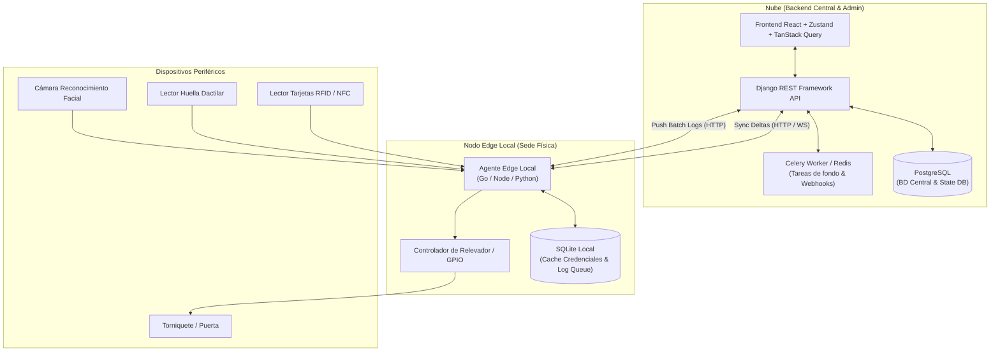
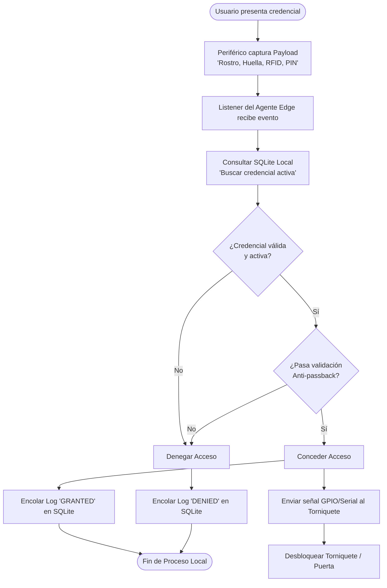
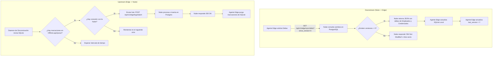
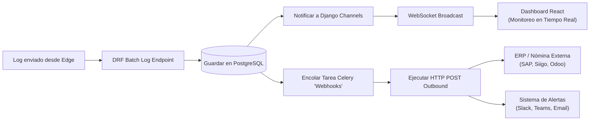

# Especificación Técnica y Funcional: Sistema de Control y Registro de Acceso

## 1. Visión General

El **Sistema de Control y Registro de Acceso** es una solución integral orientada a la administración, supervisión y control del acceso de colaboradores en instalaciones corporativas o industriales.

Permite gestionar hardware de validación (torniquetes, lecturas biométricas, cámaras, colectores de datos) y centralizar la información sobre cantidad de personal en sitio, marcas de ingreso y salida, tiempos de permanencia, alertas por anomalías y métricas operativas.

---

## 2. Arquitectura de Alto Nivel

El sistema adopta una arquitectura híbrida **Cloud-Edge**:

* **Servidor Central (Cloud):** Fuente de la verdad (*Source of Truth*), administración global, panel web, analítica, emisión de reportes e integraciones con sistemas externos (ERP/Nómina vía Webhooks).
* **Agente Local (Edge Node):** Desplegado en las sedes físicas para interactuar directamente con periféricos/hardware. Cuenta con tolerancia total a caídas de Internet mediante una base de datos local y sincronización por **deltas**.

### Diagrama 1: Arquitectura General del Sistema (Híbrida Nube - Edge)



---

## 3. Requerimientos No Funcionales & Stack Tecnológico

### 3.1. Frontend (Panel de Administración Web)
* **Core Framework:** React (con TypeScript para coherencia de tipos con la API).
* **Server State & Cache:** TanStack Query (React Query) para sincronización con backend, re-intentos automáticos, gestión de estados de carga e invalidación de cache.
* **Cliente HTTP:** Axios con interceptores para inyección y renovación de tokens JWT.
* **Client-side State:** Zustand para configuraciones del panel, estado global de la interfaz y credenciales en sesión.

### 3.2. Backend & API
* **Framework Backend:** Django REST Framework (DRF).
* **Base de Datos Principal:** PostgreSQL con índices B-Tree / Hash optimizados para consultas de alto volumen de marcas.
* **Documentación & Contrato:** OpenAPI 3.0 / Swagger (mediante `drf-spectacular`).
* **Tiempo Real:** Django Channels + WebSockets (notificación instantánea de accesos denegados, puertas forzadas y estado de aforo en vivo).

### 3.3. Infraestructura & Despliegue
* **Contenedorización:** Docker & Docker Compose (orquestación aislada para Web/API, PostgreSQL, Redis/Celery y Nginx).
* **Agente Edge:** Servicio ligero (Python / Node.js / Go) con base de datos embebida (SQLite/LevelDB) para ejecución local en mini-PCs o Raspberry Pi conectadas al hardware de control.

---

## 4. Requerimientos Funcionales

### 4.1. Autenticación Multimodal
* **Mecanismos de Validación Compatibles:**
  * **Reconocimiento Facial:** Embeddings/vectores característicos.
  * **Huella Dactilar:** Templates biométricos en formatos estándar (ISO/ANSI).
  * **Proximidad RFID / NFC:** UID de tarjeta o llavero (ej. MiFare, EM-Card).
  * **Código PIN / QR Dinámico:** Entrada por teclado o lector óptico.
* **Soporte Multi-factor (MFA):** Configuración de reglas combinadas para áreas restringidas (ej. *Tarjeta + Huella*).
* **Gestión de Credenciales:** Un mismo colaborador puede tener múltiples credenciales asignadas con vigencia definida (fechas de inicio y fin de contrato).

### 4.2. Operatividad Offline y Sincronización por Deltas
* **Validación Offline-First:** Los accesos se validan localmente en el nodo Edge en $< 200\text{ ms}$, sin dependencia de la conexión a Internet.
* **Estrategia Downstream (Nube $\rightarrow$ Edge):**
  * La nube asigna un número de versión o `timestamp` incremental a los datos (`version`).
  * El Edge solicita cambios especificando la última versión procesada (`since_version`).
* **Estrategia Upstream (Edge $\rightarrow$ Nube):**
  * Las marcaciones locales se guardan en una cola inmutable local (`OfflineLogsQueue`).
  * Cuando hay conexión, se envían en lotes (*batch*) al backend central.
* **Consistencia de Tiempo:** Sincronización de reloj atómico vía protocolo NTP entre el Edge y la Nube.

#### Diagrama 2: Flujo de Validación de Acceso Offline-First (< 200 ms)



#### Diagrama 3: Protocolo de Sincronización por Deltas (Downstream & Upstream)



### 4.3. Reglas de Acceso, Anti-Passback y Aforo
* **Detección de Sentido:** Registro diferenciado de marcas de **Ingreso (IN)** y **Salida (OUT)** según el lector activado.
* **Prevención de Anti-passback (APB):**
  * **APB Duro:** Bloquea un intento de entrada si el último estado del usuario figura como dentro (*is_inside = True*).
  * **APB Blando:** Permite el acceso pero genera una marca de anomalía en el sistema.
* **Control de Aforo:** Conteo en tiempo real de colaboradores presentes en planta o en zonas específicas.

### 4.4. Reportes, Analítica y Auditoría
* **Dashboards en Vivo:** Visualización del flujo de usuarios por puerta/nodo, alertas operativas y estado de conexión de los Agentes Edge.
* **Métricas de Asistencia:**
  * Cálculo de horas de permanencia por usuario y por departamento.
  * Reporte de llegadas tardías, salidas anticipadas y ausentismo.
* **Exportación de Datos:** Exportación a formatos estándar (CSV, Excel, PDF, JSON).

### 4.5. Integraciones Exteriores (Hooks)
* **Webhooks Salientes (Outbound):** Suscripción HTTP POST a eventos clave:
  * `access.granted`: Acceso concedido exitosamente.
  * `access.denied`: Intento de acceso rechazado (credencial no válida, vencida o violación de APB).
  * `device.status_changed`: Pérdida o restablecimiento de conexión con un nodo Edge o dispositivo.
* **Integración ERP / Nómina:** API para sincronización bidireccional con software de gestión de personal.

#### Diagrama 4: Ciclo de Vida del Evento y Webhooks (Integraciones)



---

## 5. Especificación del Modelo de Datos Central (Django)

```python
import uuid
from django.db import models

class TimeStampedModel(models.Model):
    """Modelo base abstracto para Change Data Capture (CDC)."""
    id = models.UUIDField(primary_key=True, default=uuid.uuid4, editable=False)
    created_at = models.DateTimeField(auto_now_add=True, db_index=True)
    updated_at = models.DateTimeField(auto_now=True, db_index=True)
    version = models.BigIntegerField(default=1, db_index=True)

    class Meta:
        abstract = True


class Employee(TimeStampedModel):
    document_id = models.CharField(max_length=50, unique=True)
    first_name = models.CharField(max_length=100)
    last_name = models.CharField(max_length=100)
    email = models.EmailField(blank=True, null=True)
    is_active = models.BooleanField(default=True)
    is_inside = models.BooleanField(default=False)


class Credential(TimeStampedModel):
    class CredentialType(models.TextChoices):
        FACIAL = 'FACIAL', 'Rostro (Vector)'
        FINGERPRINT = 'FINGERPRINT', 'Huella (Template)'
        RFID = 'RFID', 'Tarjeta RFID/NFC'
        PIN = 'PIN', 'Código PIN'

    employee = models.ForeignKey(Employee, on_delete=models.CASCADE, related_name='credentials')
    type = models.CharField(max_length=20, choices=CredentialType.choices)
    payload = models.TextField(help_text="Vector, hash o UID procesado de la credencial")
    is_active = models.BooleanField(default=True)
    valid_from = models.DateTimeField(null=True, blank=True)
    valid_until = models.DateTimeField(null=True, blank=True)


class AccessNode(TimeStampedModel):
    """Representa la sede o el controlador Edge física."""
    name = models.CharField(max_length=100)
    api_key = models.CharField(max_length=255, unique=True)
    last_sync_at = models.DateTimeField(null=True, blank=True)
    last_sync_version = models.BigIntegerField(default=0)


class AccessLog(models.Model):
    """Registro histórico e inmutable de eventos de marcación."""
    class Direction(models.TextChoices):
        IN = 'IN', 'Ingreso'
        OUT = 'OUT', 'Salida'

    class Status(models.TextChoices):
        GRANTED = 'GRANTED', 'Concedido'
        DENIED = 'DENIED', 'Denegado'

    id = models.UUIDField(primary_key=True, default=uuid.uuid4, editable=False)
    node = models.ForeignKey(AccessNode, on_delete=models.PROTECT)
    employee = models.ForeignKey(Employee, on_delete=models.SET_NULL, null=True, blank=True)
    credential = models.ForeignKey(Credential, on_delete=models.SET_NULL, null=True, blank=True)
    
    timestamp = models.DateTimeField(db_index=True)
    direction = models.CharField(max_length=3, choices=Direction.choices)
    status = models.CharField(max_length=10, choices=Status.choices)
    denial_reason = models.CharField(max_length=255, blank=True, null=True)
    
    created_at = models.DateTimeField(auto_now_add=True)
```

---

## 6. Definición del Protocolo de Sincronización API (Deltas)

### 6.1. Downstream: Obtener Deltas (Nube $\rightarrow$ Edge)

**Endpoint:** `GET /api/v1/edge/sync/delta?since_version={last_version}`  
**Headers:** `Authorization: Bearer <node_api_key>`

#### Respuesta Exitosa (`200 OK`):

```json
{
  "current_version": 1058,
  "has_more": false,
  "deltas": {
    "employees": [
      {
        "id": "e4a7c88b-1191-4e4b-97e3-0d3fdb9214a1",
        "document_id": "1098765432",
        "first_name": "Carlos",
        "last_name": "Mendoza",
        "is_active": true,
        "version": 1045
      }
    ],
    "credentials": [
      {
        "id": "c1f2e3d4-5555-4e4b-97e3-0d3fdb9214a2",
        "employee_id": "e4a7c88b-1191-4e4b-97e3-0d3fdb9214a1",
        "type": "RFID",
        "payload": "A1B2C3D4E5",
        "is_active": true,
        "valid_until": null,
        "version": 1050
      }
    ]
  }
}
```

### 6.2. Upstream: Enviar Lote de Marcas (Edge $\rightarrow$ Nube)

**Endpoint:** `POST /api/v1/edge/logs/batch`  
**Headers:** `Authorization: Bearer <node_api_key>`

#### Body de la Petición:

```json
{
  "node_id": "3b2a10c9-9821-4f1b-87a2-11a2b3c4d5e6",
  "logs": [
    {
      "local_id": "tmp_001",
      "employee_id": "e4a7c88b-1191-4e4b-97e3-0d3fdb9214a1",
      "credential_id": "c1f2e3d4-5555-4e4b-97e3-0d3fdb9214a2",
      "timestamp": "2026-10-18T08:00:15.123Z",
      "direction": "IN",
      "status": "GRANTED",
      "denial_reason": null
    }
  ]
}
```

---

## 7. Directivas de Seguridad y Protección de Datos

1. **Protección Biométrica:** Queda estrictamente prohibido almacenar imágenes biométricas crudas (fotos faciales completas o imágenes de huellas). Solo se persistirán vectores/embeddings no reversibles.
2. **Autenticación Inter-nodo:** La comunicación entre Nube y Nodos Edge se realizará vía HTTPS utilizando **mTLS** o tokens de API rotativos firmados con **HMAC-SHA256**.